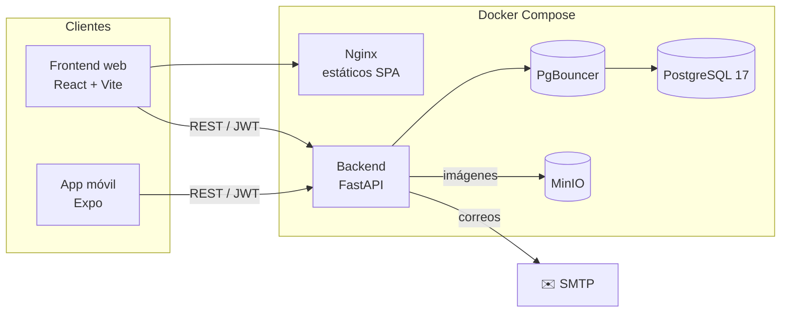
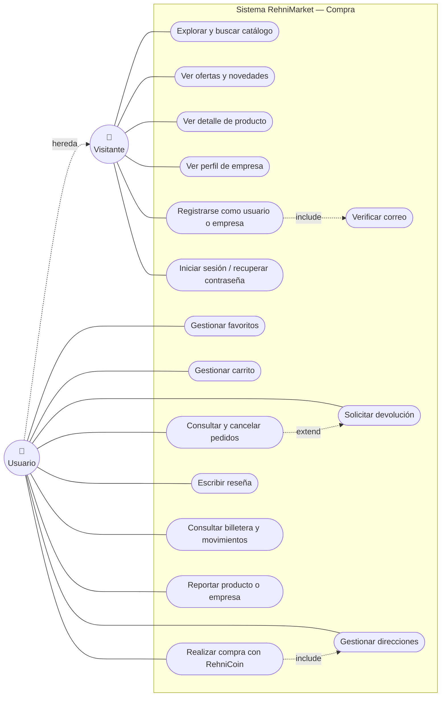
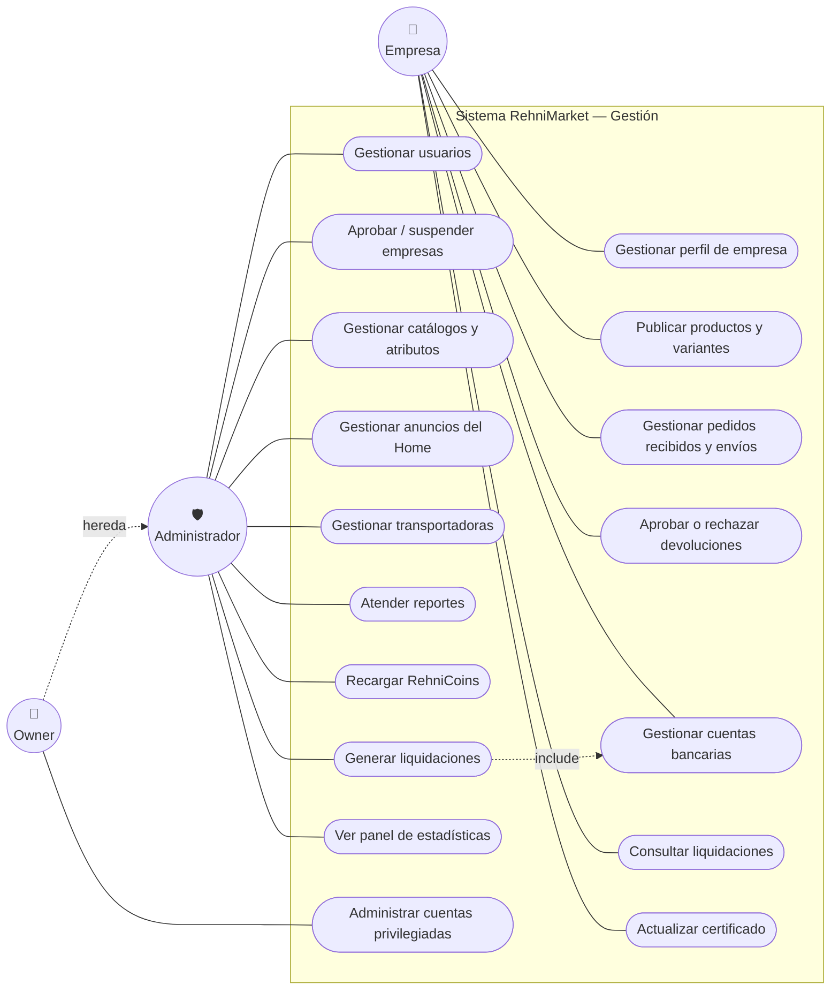
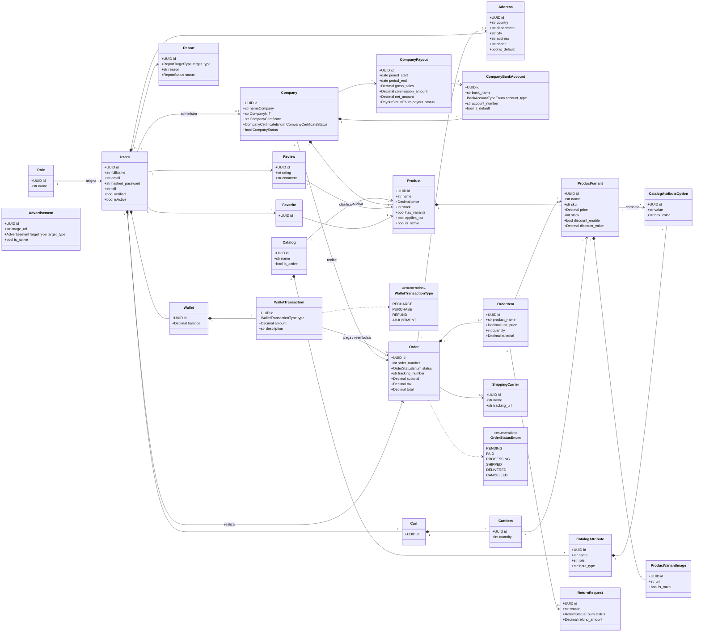

<div align="center">


### Marketplace multiempresa con billetera digital propia

Conecta **empresas vendedoras** con **compradores** en una sola plataforma: catálogo con variantes, carrito, checkout con **RehniCoin**, pedidos, devoluciones, reseñas y paneles de gestión para empresas y administradores.

<br />


</div>

---

## Tabla de contenido

- [Sobre el proyecto](#sobre-el-proyecto)
- [Funcionalidades](#funcionalidades)
- [Stack tecnológico](#stack-tecnológico)
- [Arquitectura](#arquitectura)
- [Diagramas](#diagramas)
- [Estructura del repositorio](#estructura-del-repositorio)
- [Puesta en marcha](#puesta-en-marcha)
- [Pruebas](#pruebas)
- [Scripts de operación](#scripts-de-operación)
- [Autor](#autor)

---

## Sobre el proyecto

**RehniMarket** es un marketplace en el que múltiples empresas publican y venden sus productos, y los usuarios compran pagando con **RehniCoin**, la moneda interna de la plataforma. El sistema cubre el ciclo completo de una compra —desde la exploración del catálogo hasta la entrega, la reseña y una posible devolución— e incluye la parte financiera: billetera del usuario, recargas, comisiones y liquidaciones a las empresas.

El proyecto está compuesto por tres aplicaciones:

| Aplicación | Descripción |
|---|---|
| **Backend** | API REST que concentra toda la lógica de negocio, la autenticación y el acceso a datos. |
| **Frontend web** | SPA para compradores, empresas y administradores. |
| **Mobile** | App móvil para compradores, construida con Expo. |

### Roles

| Rol | Qué puede hacer |
|---|---|
| **Visitante** | Explorar el catálogo, ver productos, ofertas, novedades y perfiles de empresa. |
| **Usuario** | Favoritos, carrito, compras, pedidos, reseñas, devoluciones, direcciones y billetera RehniCoin. |
| **Empresa** | Gestionar su perfil, catálogo con variantes, pedidos recibidos, envíos, devoluciones, cuentas bancarias y liquidaciones. |
| **Administrador** | Usuarios, empresas, catálogo global y atributos, anuncios, transportadoras, reportes, recargas y liquidaciones. |
| **Owner** | Todo lo del administrador, más la gestión de cuentas con privilegios elevados. |

---

## Funcionalidades

<table>
<tr>
<td width="50%" valign="top">

** Comercio**
- Catálogo público con búsqueda, filtros y orden
- Secciones de **Ofertas** y **Novedades**
- Productos con **variantes** (precio, stock, imágenes y atributos propios)
- Favoritos y carrito
- Checkout con cobro en RehniCoin e IVA
- Seguimiento de pedidos y transportadoras
- Cancelación con reembolso automático e idempotente
- Solicitudes de **devolución** por ítem
- Reseñas y calificaciones de productos comprados

</td>
<td width="50%" valign="top">

**Gestión y finanzas**
- Panel de empresa: productos, pedidos, devoluciones y finanzas
- Panel administrativo con estadísticas de la plataforma
- Billetera **RehniCoin** con historial de movimientos
- Recargas de saldo gestionadas por administración
- Liquidaciones a empresas con comisión configurable
- Anuncios del Home con segmentación
- Reportes de contenido y moderación
- Registro de empresas con validación de NIT y certificado

</td>
</tr>
<tr>
<td valign="top">

**Seguridad**
- Autenticación con **JWT** + refresh tokens
- Contraseñas con hash **bcrypt / argon2**
- Verificación de correo con códigos temporales
- Recuperación de contraseña
- Permisos por rol (lista blanca) validados contra la BD
- Rate limiting y CORS configurables

</td>
<td valign="top">

**Plataforma**
- Imágenes almacenadas en **MinIO** y servidas por proxy
- Correos transaccionales con plantillas **Jinja2**
- Migraciones versionadas con **Alembic**
- Pool de conexiones con **PgBouncer**
- Healthchecks y límites de recursos por servicio
- Scripts de backup, restauración y pruebas de carga

</td>
</tr>
</table>

---

## Stack tecnológico

### Backend

| Tecnología | Uso |
|---|---|
|  | Lenguaje principal |
|  | Framework de la API REST |
|  | Servidor ASGI |
|  | ORM |
|  | Migraciones de base de datos |
|  | Validación y esquemas |
| -000000?logo=jsonwebtokens&logoColor=white) | Autenticación |
|  | Gestor de dependencias |
|  | Pruebas automatizadas |

### Frontend web

| Tecnología | Uso |
|---|---|
|  | Librería de UI |
|  | Tipado estático |
|  | Bundler y servidor de desarrollo |
|  | Estilos y design system |
|  | Enrutamiento |
|  | Cliente HTTP |
|  | Iconografía |
|  | Pruebas unitarias |
|  | Gestor de paquetes |

### Mobile

| Tecnología | Uso |
|---|---|
|  | Plataforma de desarrollo |
|  | Framework móvil |
|  | Navegación basada en archivos |
|  | Almacenamiento seguro de sesión |

### Infraestructura y datos

| Tecnología | Uso |
|---|---|
|  | Base de datos relacional |
|  | Pool de conexiones (modo transacción) |
|  | Almacenamiento de objetos (imágenes) |
|  | Orquestación de servicios |
|  | Servidor estático del frontend |
|  | Pruebas de carga |

---

## Arquitectura



El backend sigue una arquitectura por capas:

```
routers  →  services  →  repository  →  models (SQLAlchemy)
   ↑            ↑
schemas    middleware (auth, roles, CORS, rate limit)
```

---

## Diagramas

### Diagrama de casos de uso

Los roles son acumulativos: el **Usuario** puede hacer todo lo del **Visitante** y el **Owner** todo lo del **Administrador**. Para que se lea mejor, el diagrama está dividido en dos partes.

**Compra (Visitante y Usuario)**



**Gestión (Empresa, Administrador y Owner)**



### Diagrama de clases

Modelo de dominio basado en los modelos SQLAlchemy de `RehniMarket-backend/app/models`. Por legibilidad solo se muestran los atributos principales.



---

## Estructura del repositorio

```text
Rehni-Market/
├── RehniMarket-backend/      # API REST (FastAPI)
│   ├── app/
│   │   ├── core/             # Códigos de error, excepciones, config. de IVA, comisiones y billetera
│   │   ├── database/         # Motor y sesión de SQLAlchemy
│   │   ├── middleware/       # Auth, permisos por rol, CORS, rate limit
│   │   ├── models/           # Modelos ORM
│   │   ├── repository/       # Acceso a datos
│   │   ├── routers/          # Endpoints REST
│   │   ├── schemas/          # Esquemas Pydantic
│   │   ├── services/         # Lógica de negocio
│   │   └── utils/            # Seguridad, seeds, utilidades
│   ├── alembic/              # Migraciones
│   └── tests/                # Pruebas con pytest
├── RehniMarket-frontend/     # SPA web (React + Vite)
│   └── src/
│       ├── api/              # Cliente HTTP e interceptores de sesión
│       ├── features/         # Módulos por dominio (cart, orders, wallet, admin, ...)
│       ├── pages/            # Páginas públicas, de usuario y dashboards
│       ├── routers/          # Definición de rutas y guards
│       └── shared/           # Componentes y utilidades compartidas
├── RehniMarket-mobile/       # App móvil (Expo + Expo Router)
├── scripts/                  # Backup, restauración, smoke tests y carga
├── tests/load/               # Escenarios de pruebas de carga
├── docs/                     # Documentación funcional y técnica
├── docker-compose.yml        # Despliegue completo
└── docker-compose.dev.yml    # Entorno de desarrollo
```

---

## Puesta en marcha

### Requisitos previos

- [Docker](https://docs.docker.com/get-docker/) y Docker Compose
- [Node.js](https://nodejs.org/) + [pnpm](https://pnpm.io/) (para desarrollo del frontend o mobile)
- [uv](https://docs.astral.sh/uv/) y Python 3.13 (para desarrollo del backend fuera de Docker)

### 1. Clonar el repositorio

```bash
git clone https://github.com/RehnieyAl/Rehni-Market.git
cd Rehni-Market
```

### 2. Configurar variables de entorno

```bash
cp .env.example .env
cp RehniMarket-backend/.env.example RehniMarket-backend/.env
```

Edita ambos archivos con tus credenciales de PostgreSQL, MinIO, SMTP, la clave JWT y las URLs del frontend y backend.

### 3. Levantar todo con Docker

```bash
docker compose up -d --build
```

Al iniciar, el backend aplica las migraciones automáticamente (`alembic upgrade head`).

| Servicio | URL por defecto |
|---|---|
| Frontend | http://localhost:8080 |
| API | http://localhost:8000 |
| Documentación interactiva (Swagger) | http://localhost:8000/docs |

### Desarrollo local

<details>
<summary><b>Backend</b></summary>

```bash
cd RehniMarket-backend
uv sync
uv run alembic upgrade head
uv run uvicorn app.main:app --reload
```

</details>

<details>
<summary><b>Frontend web</b></summary>

```bash
cd RehniMarket-frontend
pnpm install
pnpm dev
```

</details>

<details>
<summary><b>Mobile</b></summary>

```bash
cd RehniMarket-mobile
pnpm install
pnpm exec expo start --lan
```

Escanea el código QR con **Expo Go**.

</details>

---

## Pruebas

```bash
# Backend (pytest)
cd RehniMarket-backend
RUN_SEED=false uv run pytest

# Frontend (vitest)
cd RehniMarket-frontend
pnpm test
```

Pruebas de humo y de carga:

```bash
./scripts/acceptance_smoke.sh
k6 run scripts/load_test.k6.js
```

---

## Scripts de operación

| Script | Descripción |
|---|---|
| `scripts/backup_rehnimarket.sh` | Respaldo de la base de datos y del almacenamiento |
| `scripts/restore_rehnimarket.sh` | Restauración a partir de un respaldo |
| `scripts/acceptance_smoke.sh` | Pruebas de humo sobre los flujos principales |
| `scripts/perf_test.sh` | Pruebas de rendimiento |
| `scripts/load_test.k6.js` | Escenario de carga con k6 |
| `scripts/verificar-requisitos.sh` | Verificación de requisitos del entorno |

---


## Autor

**Yeinher José Algarín Cardozo** — [@RehnieyAl](https://github.com/RehnieyAl)

<div align="center">

<br />


</div>
