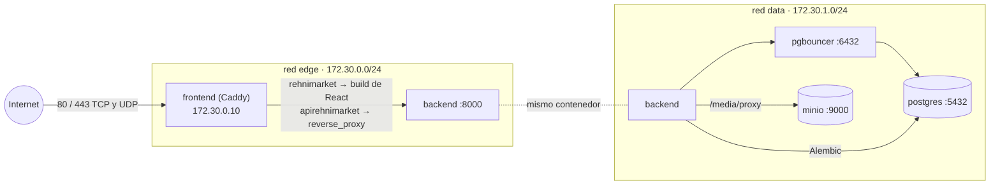

# Guía de producción — RehniMarket

Producción usa **el mismo `docker-compose.yml` y el mismo `caddy/Caddyfile`** que el desarrollo.
Solo cambia el `.env`, que sale de la plantilla [`env.prod.example`](env.prod.example).

| Archivo de `deploy/` | Para qué |
|---|---|
| `README.md` | Esta guía |
| [`env.prod.example`](env.prod.example) | Plantilla del `.env` único de producción |
| [`checklist-azure.md`](checklist-azure.md) | Lista de verificación para marcar durante el despliegue en Azure |
| [`OWNER.md`](OWNER.md) | Crear y administrar el único owner desde PostgreSQL |
| [`sql/crear-owner.sql`](sql/crear-owner.sql) | SQL que crea el owner con `psql` |

## 1. Producción

| Qué | URL |
|---|---|
| Web (frontend) | <https://rehnimarket.duckdns.org> |
| API (backend) | <https://apirehnimarket.duckdns.org> (salud: `/health/database`) |

Swagger (`/docs`) está apagado en producción (`DOCS_ENABLED=false`).

## 2. Arquitectura



| Servicio | Redes | Expone en el host | Notas |
|---|---|---|---|
| `frontend` (Caddy) | `edge` | `0.0.0.0:80`, `0.0.0.0:443` TCP/UDP | Único punto de entrada; HTTPS con Let's Encrypt |
| `backend` | `edge` y `data` | `127.0.0.1:8000` | Solo el propio servidor; desde Internet se entra por Caddy |
| `pgbouncer` | `data` | Nada | Pool de conexiones del backend |
| `postgres` | `data` | `127.0.0.1:5433` | Solo el propio servidor (`docker compose exec` o túnel SSH) |
| `minio` | `data` | Nada | Las imágenes salen por el backend en `/media/proxy` |

Detalle y pruebas de aislamiento: plan de implantación §7.6 y `scripts/verificar-redes.sh`.

## 3. Requisitos de la VM

| Recurso | Mínimo | Medido en la VM de Azure (16/11/2026) |
|---|---|---|
| Sistema | Ubuntu Server 24.04 LTS x86_64 | Ubuntu 24.04.5 LTS |
| CPU | 2 vCPU | 2 |
| RAM | 4 GiB (los límites del compose suman 2,25 GiB) | 3,8 GiB |
| Disco | 30 GB | 29 GB (26 GB libres) |
| Docker / Compose | Docker Engine reciente y Compose ≥ 2.24 | Docker 29.9.3, Compose 5.7.1 |

Con 2 vCPU, en el `.env`: `BACKEND_CPUS=2`, `POSTGRES_CPUS=1.5`, `UVICORN_WORKERS=2`,
`THREADPOOL_SIZE=20`, `DB_POOL_SIZE=10`, `DB_MAX_OVERFLOW=15` y `PGBOUNCER_MAX_CLIENT_CONN=200`.
Docker no crea un contenedor cuyo límite de CPU supere los núcleos.

**Swap.** En marcha los límites caben en 4 GiB, pero la compilación de las imágenes (`pnpm build`,
`uv sync`) no tiene límite. Con 4 GiB o menos se recomienda 2 GiB de swap:

```bash
sudo fallocate -l 2G /swapfile && sudo chmod 600 /swapfile
sudo mkswap /swapfile && sudo swapon /swapfile
echo '/swapfile none swap sw 0 0' | sudo tee -a /etc/fstab
```

Comprobación automática: `PORTS="80 443" bash scripts/verificar-requisitos.sh`.

## 4. DNS y red

**DuckDNS** (<https://www.duckdns.org>): dos registros con la IP pública de la VM.

| Dominio | Para |
|---|---|
| `rehnimarket` | Web |
| `apirehnimarket` | API |

Comprobar antes de levantar Caddy (Let's Encrypt limita los intentos fallidos):
`nslookup rehnimarket.duckdns.org` y `nslookup apirehnimarket.duckdns.org` devuelven `<ip-de-la-vm>`.

**Reglas de entrada** (grupo de seguridad de red de Azure):

| Puerto | Abierto | Motivo |
|---|:---:|---|
| 22/TCP | Sí, solo desde la IP del administrador | SSH con llave |
| 80/TCP | Sí | Let's Encrypt (HTTP-01) y redirección a HTTPS |
| 443/TCP y 443/UDP | Sí | HTTPS y HTTP/3 |
| 5432, 5433, 6432, 8000, 9000, 9001 | **Nunca** | Base de datos, PgBouncer, API directa y MinIO quedan dentro del servidor |

## 5. Configuración

Toda la configuración es **un solo `.env`** en la raíz del proyecto. Dos formas:

```bash
# A · desde la plantilla, en la VM
cp deploy/env.prod.example .env && chmod 600 .env
nano .env   # reemplazar cada CAMBIAR_*

# B · copiar un .env de producción ya preparado en el equipo del administrador
scp .env.produccion <usuario>@<ip-de-la-vm>:~/Rehni-Market/.env
ssh <usuario>@<ip-de-la-vm> "chmod 600 ~/Rehni-Market/.env"
```

Qué cambiar respecto de la plantilla:

- `POSTGRES_PASSWORD`, `MINIO_ROOT_PASSWORD` y `SECRET_KEY`: generar cada una con
  `openssl rand -base64 24 | tr '+/' '-_'` (sin `+` ni `/`, que romperían las URL de conexión).
- **`POSTGRES_PASSWORD` se repite, igual, dentro de `URL_DATABASE` y `URL_DATABASE_POOLED`**,
  junto con `POSTGRES_USER` y `POSTGRES_DB`.
- `GMAIL_USERNAME` y `GMAIL_APP_PASSWORD` (contraseña de aplicación que emite Google).
- Los dominios ya vienen: `SITE_ADDRESS=rehnimarket.duckdns.org`, `API_ADDRESS=apirehnimarket.duckdns.org`.

Comprobación: `grep -nE '^[A-Z_]+=.*CAMBIAR' .env` no muestra nada y `ls -l .env` muestra `-rw-------`.
El `.env` nunca se sube a Git.

## 6. Primer despliegue

```bash
git clone https://github.com/RehnieyAl/Rehni-Market.git ~/Rehni-Market && cd ~/Rehni-Market
# .env según la sección 5
docker compose build backend      # de una en una: en 2 vCPU / 4 GiB las dos a la vez
docker compose build frontend     # pueden quedarse sin memoria
docker compose up -d --wait
docker compose ps                 # los cinco servicios en healthy
```

El backend aplica `alembic upgrade head` al arrancar. Caddy pide los certificados a Let's Encrypt
en el primer acceso a cada dominio.

## 7. Datos base y cuenta owner

El backend crea los datos base en cada arranque, aunque `RUN_SEED=false` (`app/utils/base_data.py`, #53):

| Datos | Cuándo se crean | Detalle |
|---|---|---|
| Roles `user`, `company`, `admin`, `owner` | **Siempre**, en cada arranque si faltan | Sin el rol `user` el registro falla |
| Categorías (120), sus especificaciones, atributos de variante y opciones | **Siempre**, solo si la tabla de categorías está vacía | Después las administra el panel; volver a sembrarlas desharía sus cambios |
| Transportadoras (4) | **Siempre**, solo si no hay ninguna | Las usan los envíos de los pedidos |
| Cuenta owner del seed (`USER_NAME_OWNER`, `OWNER_DEFAULT`, `OWNER_PASSWORD_DEFAULT`) | Solo con `RUN_SEED=true` y las tres variables con valor | En producción quedan vacías |
| Empresas y productos de demostración | Solo con `RUN_SEED=true` | Desarrollo |

Comprobación, sin modificar nada:

```bash
docker compose exec postgres sh -c 'psql -U "$POSTGRES_USER" -d "$POSTGRES_DB" -tAc "SELECT (SELECT count(*) FROM roles), (SELECT count(*) FROM catalog), (SELECT count(*) FROM shipping_carriers);"'
# 4|120|4
```

**Cuenta owner:** hay una sola y se crea directamente en PostgreSQL con
[`deploy/sql/crear-owner.sql`](sql/crear-owner.sql), nunca por la web. Procedimiento completo
(crear, convertir una cuenta registrada, comprobar, restablecer la clave, transferir y errores
frecuentes) en **[`deploy/OWNER.md`](OWNER.md)**. La base de datos, el backend y el frontend impiden
un segundo owner (§13).

## 8. Verificación

```bash
read -rs SMOKE_PASSWORD; export SMOKE_PASSWORD
SMOKE_EMAIL=<correo-de-una-cuenta-verificada> \
BASE_URL=https://apirehnimarket.duckdns.org FRONTEND_URL=https://rehnimarket.duckdns.org \
  bash scripts/smoke-test.sh      # RESULTADO: 7 pasan, 0 fallan

bash scripts/verificar-redes.sh   # 0 fallan (reinicia el backend una vez: correr antes de abrir a usuarios)
```

Desde otro equipo, `nc -zv <ip-de-la-vm> 5433` y `nc -zv <ip-de-la-vm> 9001` deben fallar.

## 9. Actualizar

```bash
bash scripts/respaldar.sh                       # siempre antes de actualizar
git pull
docker compose up -d --build --wait
```

Con versiones etiquetadas (`v*.*.*`), fijar la versión en lugar de seguir `main`:

```bash
git fetch --tags && git checkout v1.2.0
docker compose up -d --build --wait
```

Revisar antes si la versión trae migraciones no compatibles hacia atrás (plan §5.2, «Clasificación de migraciones»).

## 10. Rollback

```bash
git checkout <etiqueta-anterior>
docker compose up -d --build --wait
```

Si la versión nueva aplicó una migración **no** compatible hacia atrás, el código anterior no basta:
restaurar el respaldo previo (sección 11). No se usa `alembic downgrade`.

## 11. Respaldo y restauración

| Qué | Cómo |
|---|---|
| Respaldar | `bash scripts/respaldar.sh`: volcado de PostgreSQL y copia de MinIO, cada uno con su `.sha256` |
| Dónde quedan | `backups/postgres/` y `backups/minio/` del proyecto (fuera de Git) |
| Cada cuánto | Diario (RPO 24 h); se conservan los 7 más recientes (`KEEP_DAILY=7`) |
| Probar sin tocar producción | `bash scripts/restore_rehnimarket.sh <TS> --verify-only` |
| Restaurar | `bash scripts/restore_rehnimarket.sh <TS>` |

Copias fuera del servidor y cifrado: plan de implantación §3.3.

## 12. Logs y problemas frecuentes

```bash
docker compose logs -f --tail=100 frontend   # Caddy
docker compose logs -f --tail=100 backend
docker compose ps
```

| Síntoma | Causa probable | Qué revisar |
|---|---|---|
| Caddy no obtiene el certificado | El DNS no apunta a la VM o el puerto 80 está cerrado | `nslookup` de los dos dominios, reglas de entrada 80/443, `CADDY_LOCAL_CERTS` vacía; `docker compose logs frontend` |
| El backend no arranca o no conecta a la base | Contraseña distinta en `POSTGRES_PASSWORD` y en `URL_DATABASE*`, o un `CAMBIAR_*` sin reemplazar | `docker compose logs backend`; la base guarda la contraseña con la que se creó el volumen |
| No llegan los correos | Puerto SMTP bloqueado o contraseña de aplicación inválida | Azure bloquea el 25: usar 587 (por defecto), 465 o 2525 |
| Un contenedor se reinicia o la compilación se corta | Falta de memoria | `docker compose ps`, `free -h`, `dmesg \| grep -i oom`; agregar swap (sección 3) y compilar de una imagen a la vez |
| La web carga pero no llega a la API | `VITE_API_URL` o CORS | `VITE_API_URL` se graba al compilar (`--build`); `CORS_EXTRA_ORIGINS` y `URL_FRONTEND` |

## 13. Seguridad

- **Un solo `.env`** con todos los secretos: `chmod 600`, fuera del repositorio. Las plantillas no llevan secretos reales.
- **Caddy solo recibe sus 5 variables** (`SITE_ADDRESS`, `API_ADDRESS`, `HTTP_PORT`, `HTTPS_PORT`,
  `CADDY_LOCAL_CERTS`): el contenedor expuesto a Internet no tiene contraseñas ni la firma de los JWT.
- **Swagger apagado** (`DOCS_ENABLED=false`).
- **CORS restringido** a `https://rehnimarket.duckdns.org` (`CORS_EXTRA_ORIGINS`).
- **Rate limit** activo (`RATE_LIMIT_ENABLED=true`), con la IP real del cliente: el backend solo
  acepta `X-Forwarded-For` de Caddy (`FORWARDED_ALLOW_IPS=172.30.0.10`).
- **Un solo owner**, creado desde PostgreSQL ([`OWNER.md`](OWNER.md)): la base lo garantiza con un
  índice único y triggers, el backend responde 403 a cualquier intento de asignar, quitar, editar o
  bloquear el rol owner, y el panel no lo ofrece.
- **PostgreSQL, PgBouncer y MinIO ocultos**: en la red `data`, a la que Caddy no pertenece, y sin
  puertos hacia Internet. PostgreSQL solo en `127.0.0.1:5433`.
