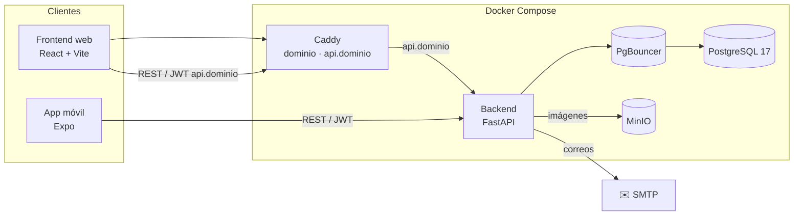
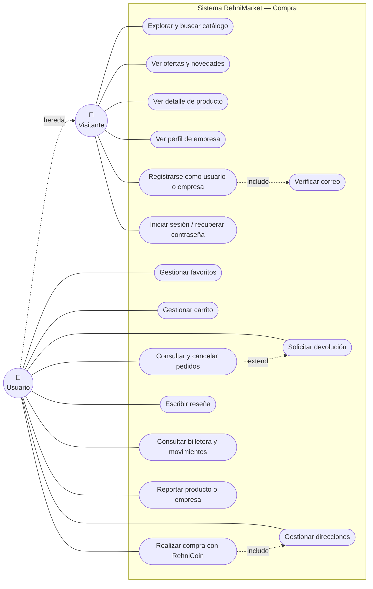
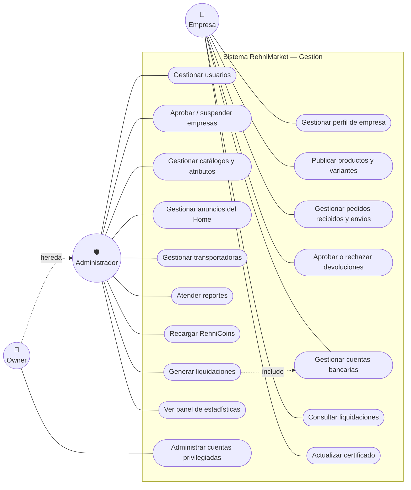
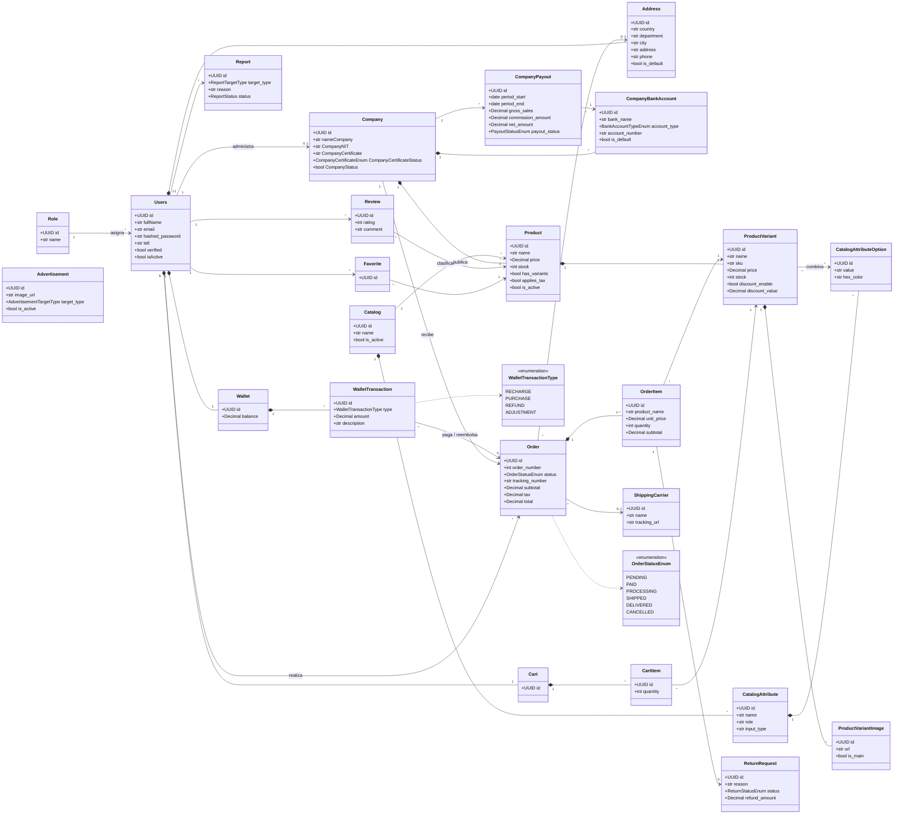

# Documentación técnica — RehniMarket

Arquitectura, diagrama de casos de uso y diagrama de clases del proyecto.

## Arquitectura



El backend sigue una arquitectura por capas:

```
routers  →  services  →  repository  →  models (SQLAlchemy)
   ↑            ↑
schemas    middleware (auth, roles, CORS, rate limit)
```

## Diagrama de casos de uso

Los roles son acumulativos: el **Usuario** puede hacer todo lo del **Visitante** y el **Owner** todo lo del **Administrador**. Para que se lea mejor, el diagrama está dividido en dos partes.

**Compra (Visitante y Usuario)**



**Gestión (Empresa, Administrador y Owner)**



## Diagrama de clases

Modelo de dominio basado en los modelos SQLAlchemy de `RehniMarket-backend/app/models`. Por legibilidad solo se muestran los atributos principales.


