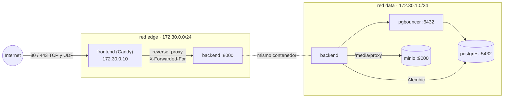

# Entregable S06 — Seguridad, Usuarios y Plan de Respaldo Final

| Campo | Valor |
|---|---|
| Proyecto | RehniMarket |
| Equipo | 1 persona (responsable técnico) |
| Versión del software | 1.0.1 |
| Fecha | 2026-11-18 |
| Semana | 6 de 9 — Seguridad, usuarios y permisos (CE-1, CE-4) |
| Guía del bootcamp | `bc-implantacion/bootcamp/week-06-seguridad_usuarios_y_permisos/3-proyecto/README.md`, plantilla `3-proyecto/starter/entregable-s06-seguridad-y-respaldo.md`, rúbrica `rubrica-evaluacion.md` |
| Sección del plan consolidado | §7 y §3 (versión final) de [`docs/plan-implantacion.md`](../plan-implantacion.md); reemplaza el respaldo v0 de la [semana 2](semana-02-migracion-respaldo-instalacion.md) |
| Estado | Parcial: 23 `[PENDIENTE]` (dependen de comandos en la VM, del cambio de roles #44 y de la restauración por un tercero) |

Servidor: VM Ubuntu 24.04 de Azure, clon en `~/Rehni-Market`. Marcadores: `<usuario-admin>`,
`<ip-de-la-vm>`, `<ip-del-administrador>`. Equipo de una persona: lo que la guía pide hacer «con
otra persona del equipo» lo hace un tercero (compañero o instructor), según
`.claude/referentes-sena.md`.

---

## 7.1 Usuarios del sistema operativo

| Cuenta | Tipo | Persona o servicio | Grupos | Inicia sesión | `sudo` permitido |
|---|---|---|---|:---:|---|
| `<usuario-admin>` (creado por Azure al crear la VM; dueño de `~/Rehni-Market`) | Persona | Responsable técnico | `sudo`, `docker` | Llave SSH ed25519 | Todo |
| `root` | Sistema | — | — | No (`PermitRootLogin no`, [`deploy/checklist-azure.md`](../../deploy/checklist-azure.md) §1) | — |
| [PENDIENTE: usuario `respaldo` de servicio (`nologin`) para el cron del respaldo, si se separa del administrador] | Servicio | cron | `docker` | No | Nada |

Archivos y carpetas sensibles:

| Ruta | Dueño:grupo | Permisos | Por qué |
|---|---|:---:|---|
| `~/Rehni-Market` | `<usuario-admin>` | 755 | Clon del repositorio; no tiene secretos fuera del `.env` |
| `~/Rehni-Market/.env` | `<usuario-admin>` | 600 | Todos los secretos de la app ([semana 4](semana-04-procedimiento-despliegue.md), §5.2, paso 8) |
| `~/Rehni-Market/backups/` | `<usuario-admin>` | [PENDIENTE: `chmod 700` y anotar `ls -ld`] | Volcados con datos personales |
| `~/.ssh/authorized_keys` | `<usuario-admin>` | 600 | Llave pública del administrador |

Comandos para obtener la evidencia en la VM:
`id; ls -ld ~/Rehni-Market ~/Rehni-Market/backups; ls -l ~/Rehni-Market/.env; sudo -l`.

**Brecha:** el grupo `docker` equivale a root (lo advierte la guía de Docker). Con una sola persona
no hay operador con `sudo` limitado; si se suma un operador, va solo con un script de reinicio en
`sudoers` y sin grupo `docker`.

## 7.2 Acceso remoto y firewall

```
[PENDIENTE: salida de `sudo sshd -T | grep -E 'passwordauthentication|permitrootlogin|pubkeyauthentication'` en la VM (esperado: no / no / yes). Si se crea /etc/ssh/sshd_config.d/10-endurecer.conf, pegarlo aquí]
```

```
[PENDIENTE: `sudo ufw status verbose` en la VM (si UFW está inactivo, el filtro es el NSG: decirlo) y reglas de entrada del NSG: `az network nsg rule list -g <grupo> --nsg-name <nsg> -o table` o captura del portal, sin la IP del administrador]
```

| Puerto | Abierto | Justificación |
|---|:---:|---|
| 22/TCP | Sí, solo desde `<ip-del-administrador>` en el NSG | Administración con llave |
| 80/TCP | Sí | Let's Encrypt (HTTP-01) y redirección a HTTPS |
| 443/TCP y 443/UDP | Sí | HTTPS y HTTP/3 (Caddy) |
| 5432, 5433 | No | PostgreSQL solo en `127.0.0.1:5433` (`POSTGRES_BIND`) |
| 6432, 9000, 9001 | No | PgBouncer y MinIO no publican puertos en el host |
| 8000 | No | API solo en `127.0.0.1` (`BACKEND_BIND`) |

Evidencia de que la base de datos no está expuesta:
[`docs/evidencias/verificacion-redes-produccion-2026-11-17.txt`](../evidencias/verificacion-redes-produccion-2026-11-17.txt)
(VM, 17/11/2026: 41 verificaciones, 0 fallan; PostgreSQL, PgBouncer, MinIO y backend no escuchan
en `0.0.0.0`). Desde fuera:

```
[PENDIENTE: desde el equipo del administrador, `for p in 5432 5433 6432 8000 9000 9001; do nc -zv -w3 <ip-de-la-vm> $p; done` (todas deben fallar), con fecha]
```

### Segmentación de redes de Docker

`docker-compose.yml` separa los servicios en dos redes ([`docker-compose.yml`](../../docker-compose.yml), `networks:`). El único
servicio que publica puertos hacia `0.0.0.0` es `frontend` (Caddy); los que guardan datos
(PostgreSQL, PgBouncer y MinIO) no están en la red de Caddy, así que un fallo en el proxy no
da acceso directo a la base de datos ni al almacenamiento.



| Servicio | Redes | Puertos en el host | Motivo |
|---|---|---|---|
| `frontend` (Caddy) | `edge` (IP fija `172.30.0.10`) | `0.0.0.0:80`, `0.0.0.0:443` TCP y UDP | Único punto de entrada. La IP fija es la única de la que el backend acepta `X-Forwarded-For` (`FORWARDED_ALLOW_IPS=172.30.0.10`) |
| `backend` | `edge` y `data` | `127.0.0.1:8000` (`BACKEND_BIND`) | Recibe a Caddy por `edge` y llega a PgBouncer, PostgreSQL y MinIO por `data` |
| `pgbouncer` | `data` | Ninguno | Solo lo usa el backend (`URL_DATABASE_POOLED`) |
| `postgres` | `data` | `127.0.0.1:5433` (`POSTGRES_BIND` / `POSTGRES_PORT`) | Lo usan PgBouncer y Alembic. En el host, solo loopback para DbSchema; en el servidor, `docker compose exec` o túnel SSH (`.env.example`, sección PostgreSQL) |
| `minio` | `data` | Ninguno (ni la API `9000` ni la consola `9001`) | Caddy no hace proxy a MinIO (`caddy/Caddyfile`): las imágenes salen por el backend en `/media/proxy`, así que `frontend` ya no depende de `minio` |
| `postgres-test` (perfil `test`) | `default`, sin otros servicios | `127.0.0.1:55433` | Base desechable de pytest, aislada del stack |

`data` no se marca `internal: true`: Docker no publicaría `127.0.0.1:5433` en el host y el
backend perdería la salida a Internet (SMTP) si solo estuviera en esa red.

**Evidencia (2026-11-16, desarrollo).** `bash scripts/verificar-redes.sh` con el stack recreado
(`docker compose down` sin `-v` y `docker compose up -d --build`; `GET /public/products` siguió
devolviendo `total=786`): 44 pruebas, 0 fallan. Salida completa en
[`docs/evidencias/verificacion-redes-2026-11-16.txt`](../evidencias/verificacion-redes-2026-11-16.txt). Resumen:

| Tipo | Prueba | Resultado |
|---|---|:---:|
| Positiva | Host → Caddy: `https://rehnimarket/` y `https://api.rehnimarket/health/database` responden 200 | ✅ |
| Positiva | Caddy → backend → MinIO: imagen de producto por `/media/proxy` (200 `image/png`) | ✅ |
| Positiva | Backend → PgBouncer → PostgreSQL y backend → PostgreSQL: `SELECT 1` | ✅ |
| Positiva | Backend → MinIO: TCP a `minio:9000` y listado del bucket `uploads` | ✅ |
| Positiva | PgBouncer → PostgreSQL: `SELECT 1` | ✅ |
| Positiva | Host → PostgreSQL en `127.0.0.1:5433` | ✅ |
| Positiva | Resiliencia: `docker compose restart backend` sin ningún 502/503/504 por Caddy, y el sitio vuelve solo | ✅ |
| Negativa | Caddy → `postgres:5432`, `pgbouncer:6432`, `minio:9000` y `minio:9001`, por nombre y por IP | ✅ (no conecta) |
| Negativa | Host → consola de MinIO `127.0.0.1:9001` y API `127.0.0.1:9000` | ✅ (no responde) |
| Negativa | Ninguna ruta de Caddy lista buckets ni abre la consola de MinIO | ✅ |
| Negativa | PostgreSQL, PgBouncer, MinIO y backend no escuchan en `0.0.0.0` (`docker port` y `ss -tln`) | ✅ |

**Caídas del frontend ↔ backend (incidencia [#48](https://github.com/RehnieyAl/Rehni-Market/issues/48)).**
Antes del cambio, un sondeo cada 0,5 s a `/health/database` por Caddy durante
`docker compose restart backend` dio 84 × 200 y 6 × 502 (≈ 3 s), con
`dial tcp 172.30.0.2:8000: connect: connection refused` en el log de Caddy. Se descartaron
memoria (`RestartCount=0`, `OOMKilled=false`, `oom_kill 0`; pico de 468 MiB de 1 GiB con 3
workers), CORS (preflight 200) y rate limit (el backend ve la IP del cliente por
`X-Forwarded-For` solo desde Caddy). La causa era el `reverse_proxy` sin reintentos; se corrigió
con `lb_try_duration` y el health check activo ([semana 3](semana-03-hosting-y-dominio.md), §4.4).

## 7.3 Roles de la base de datos

| Rol | Privilegios | No puede | Lo usa | Dónde vive su contraseña |
|---|---|---|---|---|
| `POSTGRES_USER` (p. ej. `rehni_app`) | Dueño de la base y de las tablas | — | La app (por PgBouncer) y Alembic | `~/Rehni-Market/.env` (600) |

Enlace al script de roles en el repositorio: no existe todavía.

¿Cómo se aplican las migraciones con el rol dueño en tu despliegue? Hoy el backend ejecuta
`alembic upgrade head` al arrancar con `URL_DATABASE` (conexión directa a `postgres:5432`), con el
mismo rol que usa la app.

**Brecha conocida ([#44](https://github.com/RehnieyAl/Rehni-Market/issues/44)):** la app usa el rol
dueño, así que una inyección SQL podría borrar tablas. Plan:
[PENDIENTE: (1) `deploy/sql/roles.sql` que cree `rehni_owner` (dueño, migraciones) y `rehni_app` (SELECT, INSERT, UPDATE, DELETE y uso de secuencias, sin DDL ni TRUNCATE), sin contraseñas en el archivo; (2) `URL_DATABASE` con `rehni_owner` solo para Alembic y `URL_DATABASE_POOLED` con `rehni_app`; (3) `.env.example` y `deploy/env.prod.example` con las dos cadenas ficticias; (4) pruebas negativas de 7.4. Cambio de código e infraestructura fuera de este PR].

## 7.4 Pruebas de privilegios

Roles de la aplicación (`user`, `company`, `admin`, `owner`) validados contra la base en cada
petición. Pruebas automáticas en
[`RehniMarket-backend/tests/test_auth_authorization.py`](../../RehniMarket-backend/tests/test_auth_authorization.py),
en verde en el CI de `main` ([run 44103349861](https://github.com/RehnieyAl/Rehni-Market/actions/runs/44103349861)).

| Rol | Operación | Esperado | Obtenido |
|---|---|:---:|---|
| Sin token | `GET /cart` | ❌ 401 | 401 (`smoke-test.sh`, paso 3) |
| `user` y `company` | `GET /admin/dashboard/get-users` | ❌ 403 | 403 (`test_user_cannot_reach_admin_area`, `test_company_cannot_reach_admin_area`) |
| `user` con un JWT viejo que dice `admin` | Área admin | ❌ 403 | 403 (`test_stale_admin_claim_does_not_grant_admin_access`: el rol se lee de la base) |
| Cualquiera | Crear un segundo owner en la base | ❌ | `duplicate key … uq_users_single_owner` en producción ([evidencia](../evidencias/owner-unico-produccion-2026-11-17.txt)) |
| Rol de BD de la app | `DROP TABLE <tabla>` | ❌ | ✅ hoy, porque es dueño: [PENDIENTE: repetir con `rehni_app` tras cerrar #44] |

## 7.5 Inventario de secretos

| Secreto | Da acceso a | Dónde vive (cada ambiente) | Permisos | Quién lo lee | Cómo se rota |
|---|---|---|---|---|---|
| `SECRET_KEY` | Firma de todos los JWT | `.env` de cada ambiente (distinto en producción) | 600 | Backend | Nuevo valor + `docker compose up -d backend` (cierra todas las sesiones) |
| `POSTGRES_PASSWORD` | Toda la base | `.env` (en `POSTGRES_PASSWORD`, `URL_DATABASE` y `URL_DATABASE_POOLED`) | 600 | PostgreSQL, PgBouncer, backend | `ALTER ROLE … PASSWORD` y actualizar las tres variables; reiniciar `pgbouncer` y `backend` |
| `MINIO_ROOT_PASSWORD` | Imágenes y certificados | `.env` | 600 | MinIO, backend | Cambiar y reiniciar los dos servicios |
| `GMAIL_APP_PASSWORD` | Cuenta de correo transaccional | `.env` | 600 | Backend | Revocar en la cuenta de Google y emitir otra |
| Llave SSH de la VM | Servidor completo | `~/.ssh/rehni_azure` del equipo del administrador (la pública en Azure) | 600 | Administrador | Llave nueva en Azure («Restablecer contraseña» → llave) y borrar la anterior de `authorized_keys` |
| Token de DuckDNS | Cambiar la IP de los dos dominios | Cuenta de DuckDNS; no está en la VM ni en el repositorio | — | Administrador | Regenerar en <https://www.duckdns.org> |
| `SONAR_TOKEN` | Análisis de SonarCloud | Secretos del repositorio en GitHub | — | Workflow `sonarqube.yml` | Regenerar en SonarCloud y actualizar el secreto ([semana 7](semana-07-pipeline-y-monitoreo.md), §8.2) |
| Llave `age` del respaldo | Copias 2 y 3 | [PENDIENTE: gestor de contraseñas del responsable, fuera del servidor] | — | Administrador | Generar llave nueva y recifrar las copias vigentes |

Solo Caddy (`frontend`), el único contenedor expuesto a Internet, **no** recibe el `.env`: tiene
sus cinco variables (`SITE_ADDRESS`, `API_ADDRESS`, `HTTP_PORT`, `HTTPS_PORT`,
`CADDY_LOCAL_CERTS`) y ninguna contraseña. Las plantillas versionadas
([`.env.example`](../../.env.example), [`deploy/env.prod.example`](../../deploy/env.prod.example))
no llevan secretos reales: `CAMBIAR_*` en cada uno.

Revisión del historial del repositorio (comando usado y resultado):

```
$ git log --all --diff-filter=A --name-only --format= | grep -E '(^|/)\.env(\.[a-z]+)?$' | grep -v example
RehniMarket-mobile/.env
```

Ese archivo solo contiene `EXPO_PUBLIC_API_URL` (URL pública, no es secreto). Revisión del
16/11/2026.

```
[PENDIENTE: escáner de secretos sobre todo el historial, desde la raíz del repo:
 docker run --rm -v "$PWD:/repo:ro" ghcr.io/gitleaks/gitleaks:v8.28.0 detect --source /repo --redact
 y pegar el resumen. Si aparece un secreto real: rotarlo (tabla de arriba) y anotar la rotación]
```

---

## 3. Plan de respaldo final (reemplaza la versión de la semana 2)

| Campo | Valor |
|---|---|
| Qué se respalda | Base PostgreSQL (`pg_dump -F c -Z 6`) y bucket `uploads` de MinIO (`mc mirror` + `.tar.gz`), con el mismo `TS` y un `.sha256` cada uno ([`scripts/backup_rehnimarket.sh`](../../scripts/backup_rehnimarket.sh), envoltorio [`scripts/respaldar.sh`](../../scripts/respaldar.sh)). El `.env` no entra en el respaldo: se guarda cifrado fuera del servidor |
| RPO / RTO acordados | 24 h / 4 h ([semana 2](semana-02-migracion-respaldo-instalacion.md), §3.2) [PENDIENTE: aceptación del cliente en el acta] |
| Herramienta | `pg_dump` + `mc mirror` con `sha256sum`; cifrado con `age` para las copias que salen del servidor (decisión del 04/11/2026; el bootcamp propone restic, que también cifra y deduplica) |
| Usuario del sistema y rol de base que lo ejecutan | `<usuario-admin>` (grupo `docker`) y rol `POSTGRES_USER`. [PENDIENTE: rol de solo lectura para `pg_dump` tras cerrar #44] |
| Cifrado y dónde vive la contraseña | [PENDIENTE: implementar `age -r <llave-publica>` sobre el `.dump` y el `.tar.gz` antes de copiarlos fuera; llave privada solo en el gestor de contraseñas del responsable] |
| Horario (línea de cron) | Propuesta: `0 2 * * * cd /home/rehnimarket/Rehni-Market && bash scripts/respaldar.sh >> backups/cron.log 2>&1` [PENDIENTE: instalar con `crontab -e` en la VM y pegar `crontab -l`] |
| Retención | 7 respaldos más recientes de cada tipo (`KEEP_DAILY=7`, `scripts/backup_rehnimarket.sh`) |
| Verificación automática | `sha256sum` en cada respaldo; `bash scripts/restore_rehnimarket.sh <TS> --verify-only` mensual y tras cada migración |
| Responsable | Responsable técnico |

### 3.1 Regla 3-2-1

| Copia | Medio | Ubicación | ¿Inmutable? |
|---|---|---|:---:|
| Producción | Volúmenes `postgres_data` y `minio_data` | Disco SSD de la VM de Azure | — |
| Repositorio local | Mismo disco de la VM | `~/Rehni-Market/backups/` | No |
| Copia 2 | Disco externo del administrador | Fuera de Azure, descargada por `scp`/`rsync` con llave | No |
| Copia 3 (fuera del sitio) | Almacenamiento de objetos Backblaze B2 (decisión del 04/11/2026) | Otro proveedor | [PENDIENTE: bucket con bloqueo de objetos] |

[PENDIENTE: implementar las copias 2 y 3 (hoy solo existe la del disco de la VM, que no protege de perder la VM) y anotar la fecha de la primera copia fuera del sitio].

### 3.2 Script y programación

Enlace al script en el repositorio: [`scripts/respaldar.sh`](../../scripts/respaldar.sh) →
[`scripts/backup_rehnimarket.sh`](../../scripts/backup_rehnimarket.sh) (detiene el backend mientras
copia, rota a 7, escribe `backups/backup.log`).

Log de una ejecución automática:

```
[PENDIENTE: `tail -5 ~/Rehni-Market/backups/cron.log` después de la primera ejecución del cron en la VM]
```

Ejecución manual de referencia (desarrollo, 04/11/2026): `=== FIN backup 2026-11-04_14-15 — OK ===`
en 1 min 58 s ([semana 2](semana-02-migracion-respaldo-instalacion.md), §3.5).

### 3.3 Procedimiento de restauración de desastre

Caso: la VM se pierde y hay que levantar el servicio en una VM nueva con el último respaldo. Lo
sigue alguien que no configuró el respaldo (gate de la semana 9). Runbook corto:
[`docs/runbooks/restaurar-respaldo.md`](../runbooks/restaurar-respaldo.md).

1. Crear la VM y el DNS: [semana 4](semana-04-procedimiento-despliegue.md), §5.3, pasos 1 a 5.
2. Instalar Docker y clonar en la misma etiqueta que tenía producción: §5.2, pasos 2 a 6 (`git checkout <vX.Y.Z>`).
3. Recuperar el `.env`: descifrar la copia guardada fuera del servidor y copiarla con `scp` a `~/Rehni-Market/.env`; `chmod 600 .env`. Las contraseñas deben ser las del respaldo: PostgreSQL guarda la de su volumen.
4. Traer el respaldo: copiar `rehni_market_postgres_<TS>.dump`, `rehni_market_minio_<TS>.tar.gz` y sus `.sha256` a `~/Rehni-Market/backups/postgres/` y `backups/minio/` (descifrar con `age -d` si vienen de la copia 2 o 3).
5. Comprobar las huellas: `(cd backups/postgres && sha256sum -c rehni_market_postgres_<TS>.dump.sha256)` y lo mismo en `backups/minio/` → `La suma coincide`.
6. Levantar el stack vacío: `docker compose build backend && docker compose build frontend && docker compose up -d --wait`. Crea el rol `POSTGRES_USER` (dueño) y el esquema de la versión.
7. Probar el respaldo sin tocar nada: `bash scripts/restore_rehnimarket.sh <TS> --verify-only` → `OK`.
8. Restaurar: `bash scripts/restore_rehnimarket.sh <TS>` → `OK: restore completo.` Los roles de la app (`user`, `company`, `admin`, `owner`) y el owner vienen en el volcado; el rol de base es el del `.env`.
9. Verificar: `docker compose exec backend uv run alembic current` = la del respaldo; conteos de `roles`, `users`, `products`, `orders` iguales a los anotados; consulta de owner de [`deploy/OWNER.md`](../../deploy/OWNER.md) §4 = una fila; `scripts/smoke-test.sh` → `7 pasan, 0 fallan`.
10. Registrar: `TS`, hora de inicio y fin, tiempo total frente al RTO de 4 h y desviaciones del procedimiento.

### 3.4 Restauración probada

| Campo | Valor |
|---|---|
| Fecha | [PENDIENTE: fecha de la restauración por un tercero (simulacro de la semana 9)] |
| Quién restauró (rol en el equipo) | [PENDIENTE: tercero, compañero o instructor; equipo de 1 persona] |
| Instantánea usada y repositorio | [PENDIENTE: `TS` del respaldo de producción usado] |
| Inicio / fin | [PENDIENTE] |
| Tiempo total vs RTO | [PENDIENTE: tiempo medido / 4 h] |

Huellas antes y después:

```
[PENDIENTE: sha256sum -c de los dos archivos y conteos por tabla en origen y en la base restaurada]
```

Problemas encontrados y cambios hechos al procedimiento: [PENDIENTE: lo que salga de la prueba].

Prueba de referencia hecha por el responsable (no cuenta como «otra persona»): 04/11/2026, base
restaurada en 1,0 s en una base aparte con los 10 conteos iguales y verificación completa en
12,8 s, frente a un RTO de 4 h ([semana 2](semana-02-migracion-respaldo-instalacion.md), §3.5).
