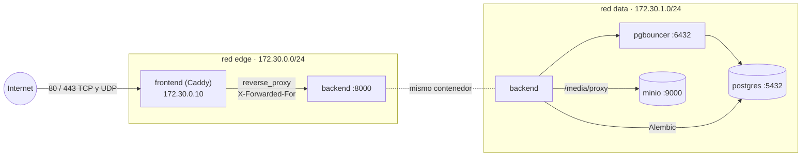

# Plan de Implantación — RehniMarket

> Plantilla: `bc-implantacion/docs/plan-implantacion-template.md`. Documento consolidado para la
> semana 9 (gate): reúne las secciones 1-5 escritas entre las semanas 1 y 4 (antes en
> `docs/plan de implantacion - Rehnimarket/`) y agrega las secciones 6-10. Solo datos
> sintéticos: ninguna IP, usuario ni contraseña real.

| Campo | Valor |
|---|---|
| Proyecto | RehniMarket |
| Equipo | 1 persona (responsable técnico) |
| Versión del plan | 1.0 |
| Versión del software | 1.0.0 (`CHANGELOG.md`; etiqueta `v1.0.0` [PENDIENTE: la crea el responsable]) |
| Fecha | 2026-11-16 |
| Servidor de producción | VM Ubuntu Server 24.04 LTS en Azure [PENDIENTE: tamaño y región; el Manual técnico en edición menciona Oracle Cloud A1, confirmar proveedor] |

Pendientes abiertos de las semanas 1-4: `docs/plan de implantacion - Rehnimarket/PENDIENTES-s1-s4.md`.

---

## 1. Ficha técnica y requisitos mínimos — Semana 1 (CE-1, CE-2)

### 1.1 Descripción técnica

Rehni-Market es una plataforma de comercio electrónico que permite a los usuarios consultar productos, gestionar el carrito de compra y realizar pedidos, mientras que las empresas pueden publicar y administrar sus productos. Los administradores y el propietario gestionan usuarios, empresas, permisos y diferentes aspectos administrativos.

**Arquitectura.** La solución sigue una arquitectura de **frontend web + API backend + servicios de infraestructura**, desplegada con Docker Compose (`docker-compose.yml`) en un único servidor. El navegador solo se comunica con Caddy (contenedor `frontend`), que sirve el frontend y hace de reverse proxy de la API; la base de datos y el almacenamiento de archivos quedan dentro de la red interna de Docker.

| Servicio (contenedor) | Tecnología | Función | Puerto en el servidor |
|---|---|---|---|
| `rehni-frontend` | Caddy 2.11 + build de React 19 (Vite) | Sirve el frontend y actúa como reverse proxy de la API | 80 (HTTP, redirige a HTTPS) y 443 (HTTPS), `docker-compose.yml:265-267` (`HTTP_PORT` / `HTTPS_PORT`; sección 4.5) |
| `rehni-backend` | FastAPI sobre Python 3.13 y Uvicorn | API REST; al arrancar aplica las migraciones de Alembic (`docker-compose.yml:197`) | 8000 (`docker-compose.yml:199`; en producción solo en `127.0.0.1`) |
| `pgbouncer_pool` | PgBouncer | Pool de conexiones entre la API y PostgreSQL | No se publica |
| `rehni-postgres` | PostgreSQL 17 | Base de datos relacional | No se publica |
| `rehni-minio` | MinIO | Almacenamiento de imágenes y archivos (bucket `uploads`) | No se publica |

**Sistema operativo seleccionado.** Producción: **Ubuntu Server 24.04 LTS** (x86_64/amd64) con Docker Engine y el plugin Docker Compose; detalle en la sección 1.3. El equipo de desarrollo, donde se hicieron las mediciones de esta sección, usa CachyOS Linux x86_64.

**Requisitos mínimos (resumen de la matriz 1.5).** 2 vCPU, 4 GB de RAM, 30 GB de disco SSD, red de 100 Mbps, arquitectura x86_64, Ubuntu Server 24.04 LTS, Docker 24.0 o superior y los puertos 8080 y 8000 libres (80 y 443 en producción).

**Verificación.** El script `scripts/verificar-requisitos.sh` comprueba CPU, RAM, disco, arquitectura, sistema operativo, versión de Docker y puertos, y termina con código `0` si todo cumple (resultado en la sección 1.7).

### 1.2 Inventario de software

Versiones obtenidas el 04/11/2026 de los contenedores en marcha (`caddy version`, `postgres --version`, `pgbouncer --version`, `minio --version`, `python --version`), de `RehniMarket-backend/uv.lock` / metadatos del paquete instalado y de `RehniMarket-frontend/pnpm-lock.yaml` / `node_modules/<paquete>/package.json`.

Licencias: del archivo de licencia o metadato de la imagen o paquete, o del repositorio o página oficial citados (consultados el 04/11/2026).

| Componente | Función | Versión | Licencia | ¿Genera costo? |
|---|---|---|---|---|
| Ubuntu Server | Sistema operativo del servidor de producción | 24.04 LTS | Obra agregada: cada paquete con su propia licencia; descarga y actualizaciones gratuitas (sección 1.3) | No |
| PostgreSQL | Base de datos relacional | 17.10 (`postgres:17-alpine`) | PostgreSQL License («PostgreSQL is released under the PostgreSQL License», <https://www.postgresql.org/about/licence/>) | No |
| PgBouncer | Pool de conexiones | 1.26.0 (`edoburu/pgbouncer:latest`, `docker-compose.yml:104`) | ISC (`COPYRIGHT` del repositorio oficial, «ISC License», <https://github.com/pgbouncer/pgbouncer/blob/master/COPYRIGHT>; también el metadato `apk` de la imagen: `license: ISC`, aunque registra el paquete 1.25.2 y el binario es 1.26.0) | No |
| MinIO | Almacenamiento de objetos/archivos | RELEASE.2026-10-23T20-06-51Z (imagen de Chainguard `cgr.dev/chainguard/minio`, fijada por digest, `docker-compose.yml:22`; `minio/minio` ya no se puede descargar de Docker Hub) | AGPLv3 (Chainguard la construye desde el código de MinIO) | No |
| Caddy | Servidor web y reverse proxy (contenedor `frontend`) | v2.11.7 (`caddy:2.11-alpine`, `RehniMarket-frontend/Dockerfile:22`) | Apache-2.0 (etiqueta `org.opencontainers.image.licenses` de la imagen) | No |
| Python | Runtime del backend | 3.13.14 (`python:3.13-slim`, `RehniMarket-backend/Dockerfile:1`) | PSF License v2 (`/usr/local/lib/python3.13/LICENSE.txt` de la imagen `python:3.13-slim`, L73: «PYTHON SOFTWARE FOUNDATION LICENSE VERSION 2») | No |
| uv | Gestor de dependencias del backend | 0.11.29 (`ghcr.io/astral-sh/uv:latest`, `RehniMarket-backend/Dockerfile:5`) | MIT o Apache-2.0, a elección («uv is licensed under either of … Apache License, Version 2.0 … MIT license … at your option», <https://github.com/astral-sh/uv>) | No |
| FastAPI | Framework para API REST | 0.135.1 | MIT | No |
| Uvicorn | Servidor ASGI | 0.41.0 | BSD-3-Clause | No |
| SQLAlchemy | ORM y acceso a PostgreSQL | 2.0.48 | MIT | No |
| Alembic | Migraciones de base de datos | 1.18.4 | MIT | No |
| Pydantic | Validación y esquemas de datos | 2.12.5 | MIT | No |
| React | Biblioteca para frontend | 19.2.7 | MIT | No |
| TypeScript | Tipado estático del frontend | 6.0.3 | Apache-2.0 | No |
| Vite | Herramienta de desarrollo y compilación | 8.1.0 | MIT | No |
| Tailwind CSS | Framework de estilos | 4.3.2 | MIT | No |
| Node.js | Runtime de compilación del frontend | 22.23.1 (`node:22-alpine`, `RehniMarket-frontend/Dockerfile:1`) | Texto de permiso de la licencia MIT (`LICENSE` de <https://github.com/nodejs/node>: «Node.js is licensed for use as follows: … Permission is hereby granted, free of charge…»; incluye componentes de terceros con sus licencias) | No |
| pnpm | Gestor de paquetes | 11.15.0 (`RehniMarket-frontend/Dockerfile:6`) | MIT («The MIT License (MIT)», `LICENSE` de <https://github.com/pnpm/pnpm>) | No |
| Docker Engine | Contenedorización | 29.6.2 (equipo de desarrollo, `docker version`) | Apache-2.0 (`LICENSE` de <https://github.com/moby/moby>: «Apache License Version 2.0») | No |
| Docker Compose | Orquestación de servicios | 5.3.1 (equipo de desarrollo, `docker compose version`) | Apache-2.0 (`LICENSE` de <https://github.com/docker/compose>: «Apache License Version 2.0») | No |

### 1.3 Sistema operativo del servidor

| Campo | Valor |
|---|---|
| Distribución y versión | Ubuntu Server 24.04 LTS (Noble) |
| Arquitectura | amd64 (x86_64). Canonical también publica arm64 y otras: «Ubuntu Server supports various 64-bit architectures and 32-bit arm.» |
| Fin de soporte estándar | Mayo de 2029. Fila de 24.04 LTS en <https://ubuntu.com/about/release-cycle>: «Standard security maintenance / May 2029 / Expanded security maintenance / May 2034». La misma página: «LTS are released every two years and receive 5 years of standard security maintenance.» |
| Licencia | Sin costo. <https://canonical.com/legal/intellectual-property-policy> (redirección de `ubuntu.com/licensing`): «Ubuntu is an aggregate work of many works, each covered by their own licence(s).» y «You can download, install and receive updates to Ubuntu for free.» |
| Requisitos mínimos oficiales (enlace) | <https://ubuntu.com/server/docs/reference/installation/system-requirements/> («The numbers below are true for Ubuntu 24.04 LTS (Noble) amd64»): RAM mínima 1.5 GB (ISO) / 1 GB (imágenes cloud), sugerida «3 GB or more»; almacenamiento mínimo 5 GB (ISO) / 4 GB (cloud), sugerido «25 GB or more». La página no fija un mínimo de CPU. |

Páginas consultadas el 04/11/2026. La versión puntual (24.04.x) no aparece en esas páginas. <!-- PENDIENTE: anotar la versión puntual (24.04.x) instalada en el servidor (`lsb_release -d`). -->

**Equipo de desarrollo (donde se midió).** CachyOS Linux x86_64 (*rolling release*, sin `VERSION_ID`), kernel 7.1.4-1-cachyos, 12 procesadores, 7150 MB de RAM y swap en `zram` (`/proc/swaps`).

### 1.4 Medición de consumo

Medido el 04/11/2026 en el equipo de desarrollo (12 procesadores, 7150 MB de RAM, swap en `zram`), con los cinco servicios de `docker-compose.yml`. **Medición en local**, no en el servidor de producción. [PENDIENTE: repetir contra la URL de producción en Azure]

- **Reposo:** 3 muestras de `docker stats --no-stream` entre las 14:14:22 y las 14:14:37 UTC, sin tráfico; se toma la mayor de cada servicio.
- **Carga simulada con:** `k6 run -e BASE_URL=http://localhost:8000 -e VUS=50 scripts/load_test.k6.js`, de 14:22:42 a 14:30:13 UTC. Son 50 usuarios virtuales concurrentes (5 min de subida, 2 min sostenidos, 30 s de bajada) que recorren catálogo, búsqueda, detalle, ofertas y novedades (solo `GET` a `/public/*`). Resultado de k6: 42 940 peticiones (95,4/s), 0 % de fallos, p95 = 75,91 ms y todos los umbrales del script en verde. Durante la prueba se tomaron 88 muestras de `docker stats` (cada ~5 s); se toma la mayor de cada servicio. **Supuesto:** 50 usuarios concurrentes **no es la carga esperada del cliente**. No hay ningún dato de concurrencia esperada en el repositorio (los requisitos no funcionales de rendimiento, RNF-011 y RNF-012, no fijan usuarios). Se eligió 50 como carga moderada para no agotar la memoria del equipo de desarrollo (7 GB, ya con swap en uso). El valor por defecto del script, 1000 (`scripts/load_test.k6.js:8`), tampoco está justificado por un requisito. <!-- PENDIENTE: concurrencia esperada (usuarios simultáneos en hora pico) acordada con el cliente; repetir k6 con ese valor y recalcular la matriz 1.5. -->
- **RAM + swap:** el equipo usa swap en `zram`, así que `docker stats` (memoria residente) no muestra lo que el servicio tiene en swap. Por eso se registra también `memory.current + memory.swap.current` del cgroup de cada contenedor (`/sys/fs/cgroup/system.slice/docker-<id>.scope/`). Es la columna que se usa para dimensionar.

| Servicio | RAM reposo (`docker stats`) | RAM + swap reposo (cgroup) | RAM pico (`docker stats`) | RAM + swap pico (cgroup) | CPU pico |
|---|---:|---:|---:|---:|---:|
| `rehni-backend` (FastAPI, 3 workers) | 26,8 MiB | 341,3 MiB | 295,4 MiB | 354,8 MiB | 193,2 % |
| `rehni-frontend` (Caddy) | 9,1 MiB | 22,6 MiB | 44,0 MiB | 47,2 MiB | 5,1 % |
| `pgbouncer_pool` (PgBouncer) | 5,6 MiB | 17,2 MiB | 9,2 MiB | 16,4 MiB | 9,5 % |
| `rehni-postgres` (PostgreSQL) | 22,9 MiB | 49,8 MiB | 43,5 MiB | 86,3 MiB | 144,1 % |
| `rehni-minio` (MinIO) | 13,3 MiB | 92,1 MiB | 116,5 MiB | 143,4 MiB | 7,2 % |
| **Total** | **77,7 MiB** | **523,0 MiB** | **508,6 MiB** (suma de picos) | **646,2 MiB** (máximo simultáneo) | **344,5 %** (máximo simultáneo, 14:27:29 UTC) |

100 % de CPU equivale a un procesador completo: el pico simultáneo de 344,5 % son unos 3,4 procesadores ocupados por los cinco servicios a la vez. k6 corrió en el mismo equipo y su consumo no está en la tabla.

Datos en disco medidos el mismo día:
- Imágenes del proyecto: 1245 MB en total (`rehni-market-backend` 533 MB, `postgres:17-alpine` 424 MB, `rehni-market-frontend` 102 MB, `caddy:2.11-alpine` 94,6 MB, MinIO 62 MB, PgBouncer 30 MB).
- Volúmenes: `postgres_data` 559,8 MB, `backend_venv` 127,4 MB, `minio_data` 23,09 MB.
- Base de datos: `pg_database_size` = 16 MB.
- Respaldos: 282 MB en `backups/` con 7 conservados (cada uno: 1,6 MB el dump y 14 MB el `.tar.gz` de MinIO).


### 1.5 Matriz de requisitos

Recomendado = consumo medido + 50 % (rango del 30-50 % de la guía del bootcamp), más lo que Canonical sugiere para el propio sistema operativo (sección 1.3).

| Requisito | Mínimo | Recomendado | Justificación (cálculo) |
|---|---|---|---|
| CPU | 2 vCPU | 6 vCPU (**supuesto: 50 usuarios concurrentes**, sección 1.4) | Pico simultáneo medido con 50 usuarios concurrentes: 3,45 procesadores; 3,45 × 1,5 = 5,2 → 6 vCPU para esa concurrencia con p95 < 121 ms. Si la concurrencia acordada con el cliente es otra, este valor cambia. El mínimo de 2 vCPU sirve para menos concurrencia o mayor latencia. <!-- PENDIENTE: el mínimo no se midió en una VM de 2 vCPU; validarlo repitiendo k6 en la VM del laboratorio. --> |
| RAM | 4 GB | 8 GB | Servicios (mismo supuesto de 50 usuarios): pico simultáneo de RAM + swap de 646,2 MiB; × 1,5 = 969 MiB (≈ 0,95 GB). Sistema operativo: Canonical sugiere 3 GB o más. 3 + 0,95 = 3,95 → mínimo de 4 GB. Recomendado de 8 GB: los límites de `docker-compose.yml` suman 2304 MiB (1G + 768M + 256M + 128M + 128M, L180, L77, L36, L128, L244), y 3 GB + 2,25 GB = 5,25 GB caben con margen en 8 GB |
| Disco | 30 GB | 60 GB SSD | Sistema operativo: Canonical sugiere 25 GB o más. Proyecto medido: imágenes 1,25 GB + volúmenes 0,71 GB + respaldos 0,28 GB = 2,24 GB; × 1,5 = 3,4 GB. 25 + 3,4 = 28,4 → mínimo de 30 GB. El recomendado de 60 GB deja espacio a las imágenes que se reconstruyen en cada actualización y al crecimiento de datos |
| Tipo de disco / IOPS | SSD | SSD NVMe | Mejora los tiempos de acceso de PostgreSQL, Docker y almacenamiento de archivos. |
| Red | 100 Mbps | 1 Gbps | En la prueba de carga k6 recibió 187 MB en 7,5 min (415 kB/s ≈ 3,3 Mbit/s) con 50 usuarios, sin imágenes (solo JSON de `/public/*`). Las imágenes de MinIO (por `/media/proxy`) suben ese tráfico. <!-- PENDIENTE: medir el ancho de banda con imágenes si se quiere justificar el mínimo con un dato propio. --> |
| Arquitectura | x86_64 | x86_64 | Las imágenes del proyecto se construyen y miden en x86_64. Ubuntu Server 24.04 admite amd64 y arm64, pero arm64 no se ha probado con este stack |
| Sistema operativo | Ubuntu Server 24.04 LTS | Ubuntu Server 24.04 LTS | SO de producción elegido (sección 1.3), con soporte estándar hasta mayo de 2029 |
| Docker / runtime | Docker 24.0 + plugin Compose | Docker Engine actual del repositorio oficial + plugin Compose | 24.0 es el umbral de `verificar-requisitos.sh` (`MIN_DOCKER_VERSION`). El desarrollo usa Docker 29.6.2 y Compose 5.3.1 |
| Puertos | 80, 443 y 8000 libres (desarrollo); 80 y 443 libres (producción) | Igual | `docker-compose.yml` publica 80 y 443 (Caddy, L232-234) y 8000 (API, L170). En producción es el mismo compose: la API queda solo en `127.0.0.1` (`BACKEND_BIND`). PostgreSQL se publica solo en `127.0.0.1:5433` (L50), nunca en `0.0.0.0`; PgBouncer y MinIO no publican puertos |

Crecimiento estimado de datos: hoy la base ocupa 16 MB y MinIO 23,09 MB, con 865 productos y 4100 variantes (sección 3.5). <!-- PENDIENTE: registros/mes esperados (pedidos, productos e imágenes nuevas) según el cliente, para calcular registros/mes × tamaño promedio × meses. -->


### 1.6 Plataforma física recomendada

| Decisión | Elección | Justificación |
|---|---|---|
| Formato (torre / rack / blade) | Torre | Para una implementación pequeña o mediana resulta suficiente y facilita mantenimiento y ampliaciones. |
| Nivel RAID del servidor de base de datos | RAID 1 | Permite mantener una copia espejo y tolerar la falla de una unidad. |
| Plataforma de ejecución (bare metal / VM / contenedores) | Contenedores Docker | Es la plataforma utilizada por Rehni-Market y permite aislar los diferentes servicios. |

### 1.7 Verificación de requisitos

**Script:** `scripts/verificar-requisitos.sh` del repositorio del proyecto. Umbrales por defecto = matriz 1.5 (Ubuntu ≥ 24.04, puertos 8080 y 8000). Chequeo propio: si un puerto lo ocupa un contenedor `rehni-*` en marcha, no lo cuenta como conflicto (aparece `RehniMarket` en ENCONTRADO).

**1. Equipo de desarrollo, umbrales de producción** (`bash scripts/verificar-requisitos.sh`, 2026-11-04 14:19 UTC, código de salida `1`):

```text
REQUISITO          ESPERADO               ENCONTRADO             ESTADO
------------------------------------------------------------------------
Procesadores       >= 2                   12                     CUMPLE
RAM (MB)           >= 4096                7150                   CUMPLE
Disco libre (GB)   >= 30 en /             52                     CUMPLE
Arquitectura       x86_64 aarch64         x86_64                 CUMPLE
Sistema operativo  ubuntu >= 24.04        cachyos rolling        NO CUMPLE
Docker             >= 24.0                29.6.2                 CUMPLE
Puerto 8080        libre                  RehniMarket            CUMPLE
Puerto 8000        libre                  RehniMarket            CUMPLE

RESULTADO: 1 requisito(s) no se cumplen.
```

**2. Equipo de desarrollo, SO de desarrollo** (`OS_ID=cachyos MIN_OS_VERSION=rolling bash scripts/verificar-requisitos.sh`, misma hora, código de salida `0`):

```text
REQUISITO          ESPERADO               ENCONTRADO             ESTADO
------------------------------------------------------------------------
Procesadores       >= 2                   12                     CUMPLE
RAM (MB)           >= 4096                7150                   CUMPLE
Disco libre (GB)   >= 30 en /             52                     CUMPLE
Arquitectura       x86_64 aarch64         x86_64                 CUMPLE
Sistema operativo  cachyos >= rolling     cachyos rolling        CUMPLE
Docker             >= 24.0                29.6.2                 CUMPLE
Puerto 8080        libre                  RehniMarket            CUMPLE
Puerto 8000        libre                  RehniMarket            CUMPLE

RESULTADO: el servidor cumple todos los requisitos mínimos.
```

**3. Contenedor `ubuntu:24.04`** (`docker run --rm -v "$PWD/scripts:/s:ro" ubuntu:24.04 bash /s/verificar-requisitos.sh`, código de salida `1`). Comprueba que el chequeo de SO reconoce Ubuntu 24.04; Docker no está instalado dentro del contenedor y CPU, RAM y disco son los del anfitrión:

```text
REQUISITO          ESPERADO               ENCONTRADO             ESTADO
------------------------------------------------------------------------
Procesadores       >= 2                   12                     CUMPLE
RAM (MB)           >= 4096                7150                   CUMPLE
Disco libre (GB)   >= 30 en /             52                     CUMPLE
Arquitectura       x86_64 aarch64         x86_64                 CUMPLE
Sistema operativo  ubuntu >= 24.04        ubuntu 24.04           CUMPLE
Docker             >= 24.0                no instalado           NO CUMPLE
Puerto 8080        libre                  libre                  CUMPLE
Puerto 8000        libre                  libre                  CUMPLE

RESULTADO: 1 requisito(s) no se cumplen.
```

**Resultado.** El hardware del equipo de desarrollo cumple la matriz. El único `NO CUMPLE` de la ejecución 1 es el sistema operativo, porque el equipo no es el servidor de producción. <!-- PENDIENTE: ejecutar `PORTS="80 443" bash scripts/verificar-requisitos.sh` en el servidor Ubuntu Server 24.04 LTS (VM del laboratorio o VPS) y pegar aquí la salida con fecha; el resultado esperado es código 0. -->

---

## 2. Plan de migración de datos — Semanas 2 y 5 (CE-3)

### 2.1 Objetivo medible

Migrar a la tabla `users` (rol `user`) el 100 % de los clientes válidos del sistema anterior (`legacy-data/clientes_legado.csv`), con un reporte de rechazos en el que cada registro no migrado tenga su motivo y se cumpla `origen = migrados + rechazados`, en una ventana máxima de 2 horas, sin modificar ni eliminar ningún usuario existente.

### 2.2 Inventario de origen

| Origen | Formato | Volumen estimado | Responsable de entregarlo | Estado de calidad |
|---|---|---|---|---|
| Sistema anterior — clientes (`legacy-data/clientes_legado.csv`) | CSV con encabezado, delimitador `;`, UTF-8; columnas `codigo`, `nombre_completo`, `correo`, `fecha_alta`, `telefono` | 100 filas | Rol: responsable del sistema anterior | Datos sintéticos. Espacios y tabuladores sobrantes, correos con mayúsculas, fechas en texto (`YYYY-MM-DD` y `DD/MM/YYYY`), teléfonos con espacios; vacíos (nombre 3, correo 2, fecha 2, teléfono 2), 4 correos inválidos y 4 correos repetidos |

### 2.3 Estrategia

- Estrategia de corte (big bang / por fases) y justificación: big bang. Es una sola entidad (clientes) sin dependencias con otros datos; una única transacción (`transformar.sql`) permite conciliar y revertir el conjunto completo.
- Ventana de mantenimiento propuesta: 2 horas con `frontend` y `backend` detenidos (`docker compose stop frontend backend`), después del respaldo previo. En el ensayo del 04/11/2026 sobre una copia restaurada, las opciones 3 a 5 tardaron **12,2 s** (sección 2.9). A eso se suman el respaldo previo (1 min 58 s, sección 3.5) y la apertura y el cierre de la ventana.

### 2.4 Tabla de mapeo

| Origen | Destino | Transformación | Regla de rechazo |
|---|---|---|---|
| `correo` | `users.email` | `btrim` + minúsculas | Vacío → `CORREO_VACIO`; formato no válido → `CORREO_INVALIDO`; más de 50 caracteres → `CORREO_EXCEDE_50`; ya existe en `users` → `YA_EXISTE_DESTINO`; repetido en el origen → `DUPLICADO_ORIGEN` (se conserva la primera ocurrencia) |
| `nombre_completo` | `users."fullName"` | Espacios y tabuladores repetidos → un espacio, y `btrim` | Vacío → `NOMBRE_VACIO`; más de 50 caracteres → `NOMBRE_EXCEDE_50` |
| `telefono` | `users.tell` | Se eliminan todos los caracteres excepto dígitos y `+` | No cumple `^\+?[0-9]{7,15}$` → `TELEFONO_INVALIDO` |
| `fecha_alta` | `users.created_at` | `YYYY-MM-DD` o `DD/MM/YYYY` → fecha a las 00:00 UTC | Vacía, formato no reconocido o fecha inexistente → `FECHA_INVALIDA`; posterior a hoy → `FECHA_FUTURA` |
| `codigo` | — (solo trazabilidad en `migracion.usuarios_migrados`) | `btrim` | — |
| — | `users.hashed_password` | Hash bcrypt propio por cuenta de un secreto aleatorio (acceso con «¿Olvidaste tu contraseña?») | — |
| — | `users.role_id` / `verified` / `"isActive"` | Rol `user` / `false` / `true` | Si no existe el rol `user`, la ejecución completa falla |

### 2.5 Validaciones

| Validación | Consulta o método | Resultado esperado |
|---|---|---|
| Conciliación de conteos | Control 1 de `scripts/migracion/validar.sql` | origen = migrados + rechazados |
| Checksum | Control 9 de `validar.sql` (hash de los datos normalizados frente a los leídos de `users`) y `sha256sum` del CSV antes y después | hashes iguales |
| Usuarios existentes sin alterar | Control 8 de `validar.sql` (hash de cada fila frente a la línea base) | 0 usuarios distintos |
| Conteo en destino | Control 3 de `validar.sql` | `users` = línea base + migrados |
| Sin correos duplicados | Control 5 de `validar.sql` | 0 correos repetidos |

### 2.6 Rollback

- Criterio para ejecutar rollback: cualquier control de `validar.sql` en `FALLA`, que el SHA-256 del CSV cambie o que el cliente rechace el reporte de rechazos.
- Método principal: `scripts/migracion/rollback.sql` con el `id_ejecucion`; borra solo los usuarios de esa ejecución. Si aborta (usuario migrado modificado o referenciado por otra tabla), se restaura el respaldo previo con `bash scripts/restore_rehnimarket.sh <TS>`.
- Rol que decide: responsable técnico del proyecto (Yeinher Algarin), con aprobación del cliente.

### 2.7 Matriz de riesgos

| Riesgo | Probabilidad | Impacto | Mitigación |
|---|---|---|---|
| Formato real de fechas o codificación distinto del supuesto | Media | Alto | Las fechas no reconocidas se rechazan (`FECHA_INVALIDA`), nunca se inventan; ensayo previo con el archivo |
| Correos repetidos con distinta capitalización | Alta | Medio | Normalización a minúsculas y comparación con `lower(email)` en origen y destino |
| Registros nuevos en `users` durante la carga | Baja | Alto | `frontend` y `backend` detenidos + `LOCK TABLE public.users` en la transacción |
| Rechazo masivo por una regla mal definida | Media | Medio | Revisión del reporte de rechazos con el cliente antes de reabrir; rollback selectivo |
| Rollback selectivo imposible por actividad posterior | Media | Alto | Respaldo previo obligatorio y restauración con `restore_rehnimarket.sh` |
| Exposición de datos personales del archivo de origen | Media | Alto | Copia solo en `/tmp/migracion` del contenedor, borrada al cerrar la ventana; solo datos sintéticos en pruebas |

### 2.8 Ejecución de los scripts

Los scripts se ejecutan con un menú, desde la raíz del proyecto y con los contenedores en marcha:

```bash
bash scripts/migracion/migrar.sh
```

| Opción | Acción | Impacto |
|---|---|---|
| 1 | Respaldo previo (`backup_rehnimarket.sh`, o su envoltorio `respaldar.sh`) | Respaldo de PostgreSQL y MinIO; detiene el backend mientras dura (1 min 58 s medidos el 04/11/2026, sección 3.5). No modifica datos |
| 2 | Abrir ventana | Detiene `frontend` y `backend` y copia el CSV y los scripts al contenedor. La aplicación queda fuera de servicio |
| 3 | `carga-staging.sql` | Carga las 100 filas en el esquema `migracion`. No toca `users` |
| 4 | `transformar.sql` | Inserta los clientes válidos en `users` en una sola transacción. Único paso que escribe en `users` |
| 5 | `validar.sql` | Solo lectura: 11 controles. Correcto si da `OK=10` y `FALLA=0` |
| 6 | `rollback.sql` | Borra solo los usuarios de la ejecución (pide escribir `SI`) |
| 7 | Cerrar ventana | Exporta el reporte de rechazos a `backups/` y reabre la aplicación. Solo se permite si la validación fue correcta |
| 8 | Restaurar el respaldo previo | Contingencia si el rollback aborta: descarta todos los cambios posteriores al respaldo (pide escribir `SI`) |
| 9 | Ver estado | Muestra el respaldo, la última validación, el número de usuarios y las ejecuciones |

Orden normal: 1 → 2 → 3 → 4 → 5 → 7. Si la validación falla: 6 (y 8 si el rollback aborta).

### 2.9 Ensayo sobre una copia restaurada

Ejecutado el 04/11/2026 a las 14:41 UTC. Se hizo sobre una **base aparte** (`rehnimarket_ensayo`), restaurada del respaldo `2026-11-04_14-31`, y no sobre la base de desarrollo. La aplicación siguió en marcha, porque no usa esa base. Se aplicaron los mismos SQL que ejecuta `migrar.sh` (opciones 3 a 6), con `psql -d rehnimarket_ensayo`:

```bash
TS=2026-11-04_14-31; DB=rehnimarket_ensayo
(cd backups/postgres && sha256sum -c "rehni_market_postgres_${TS}.dump.sha256")
docker cp "backups/postgres/rehni_market_postgres_${TS}.dump" rehni-postgres:/tmp/ensayo.dump
docker exec rehni-postgres sh -c 'createdb -U "$POSTGRES_USER" rehnimarket_ensayo && pg_restore -U "$POSTGRES_USER" -d rehnimarket_ensayo --no-owner /tmp/ensayo.dump'
docker exec rehni-postgres mkdir -p /tmp/migracion
docker cp legacy-data/clientes_legado.csv rehni-postgres:/tmp/migracion/clientes_legado.csv
docker cp scripts/migracion/. rehni-postgres:/tmp/migracion/
q(){ docker exec -i rehni-postgres sh -c 'psql -U "$POSTGRES_USER" -d rehnimarket_ensayo -v ON_ERROR_STOP=1 "$@"' psql "$@"; }
SHA=$(sha256sum legacy-data/clientes_legado.csv | cut -d' ' -f1)
q -f /tmp/migracion/carga-staging.sql                               # opción 3
q -v archivo_sha256="$SHA" -f /tmp/migracion/transformar.sql        # opción 4
ID=$(q -Atc "SELECT id_ejecucion FROM migracion.ejecuciones WHERE estado = 'APLICADA'")
q -v id_ejecucion="$ID" -f /tmp/migracion/validar.sql               # opción 5
q -v id_ejecucion="$ID" -f /tmp/migracion/rollback.sql              # opción 6 (ensayo del rollback)
docker exec rehni-postgres sh -c 'dropdb -U "$POSTGRES_USER" rehnimarket_ensayo && rm -rf /tmp/migracion /tmp/ensayo.dump'
```

Resultado: extracto de la salida, con los tiempos de cada paso medidos con `date +%s.%N`. Cada control de `validar.sql` (que psql imprime como tabla) va en una sola línea; se omiten los controles 2, 6 y 7, que también dieron `OK`. La salida completa da `OK=10`:

```
== Ensayo 2026-11-04 14:41:32 UTC | respaldo 2026-11-04_14-31 | base rehnimarket_ensayo
rehni_market_postgres_2026-11-04_14-31.dump: La suma coincide
restauración de la copia: 1.0 s
users antes: 26
SHA-256 del CSV: b29efeac92531725a599418ffe9aa17e1631c47b05ecc9c4f4ce00cf4bd8e990
--- 3) carga-staging.sql      duración: 0.1 s
--- 4) transformar.sql        duración: 12.0 s     id_ejecucion: 1
--- 5) validar.sql            duración: 0.1 s
 1. Conciliación origen = migrados + rechazados | OK | origen=100 migrados=73 rechazados=27
 3. users = línea base + migrados               | OK | antes=26 migrados=73 ahora=99
 4. Rechazos: CORREO_EXCEDE_50 1 · CORREO_INVALIDO 4 · CORREO_VACIO 2 · DUPLICADO_ORIGEN 4 ·
    FECHA_FUTURA 1 · FECHA_INVALIDA 7 · NOMBRE_EXCEDE_50 2 · NOMBRE_VACIO 2 · TELEFONO_INVALIDO 4
 5. Sin duplicados de email en users             | OK | 0 correos repetidos
 8. Preexistentes sin alterar                    | OK | 0 usuarios preexistentes distintos de la línea base
 9. Checksum normalizados = destino              | OK | esperado=cbcb1b239c3f47b57c36e76a9feb6045 obtenido=cbcb1b239c3f47b57c36e76a9feb6045
10. Hash bcrypt único por migrado                | OK | 73 migrados, 73 hashes distintos, 0 no bcrypt
11. Migrados sin verificar                       | OK | 0 verificados de 73 migrados
psql exit=0  OK=10  FALLA=0  CSV sin cambios: OK
carga + transformación + validación (opciones 3-5): 12.2 s
users después: 99
--- 6) rollback.sql   Rollback: migrados restantes en users | OK | 0 restantes
                      Rollback: preexistentes intactos      | OK | 0 distintos de la línea base
rollback exit=0  duración: 0.1 s
users tras rollback: 26
```

Casi todo el tiempo está en `transformar.sql` (12,0 s), que calcula un hash bcrypt distinto por cada uno de los 73 migrados (control 10). Después del ensayo, la base de desarrollo seguía con 26 usuarios y sin el esquema `migracion`.


---

## 3. Plan de respaldo — Semanas 2 y 6 (CE-4)

### 3.1 Qué se respalda

| Elemento | Ubicación | Método | ¿Contiene datos personales? |
|---|---|---|---|
| Base de datos PostgreSQL 17 | Contenedor `rehni-postgres`, base `rehnimarket` | `pg_dump -F c -Z 6` con `bash scripts/backup_rehnimarket.sh` | Sí |
| Archivos de MinIO (imágenes, logos, banners, certificados PDF) | Contenedor `rehni-minio`, bucket `uploads` | `mc mirror` + `.tar.gz` con `bash scripts/backup_rehnimarket.sh` (mismo `TS` que la base) | Sí |
| Configuración (`.env` único) | Raíz del proyecto | Copia cifrada con `age` (decisión del 04/11/2026; implementación: semana 6) | No (contiene credenciales) |

**Script.** El bootcamp pide `scripts/respaldar.sh`. En RehniMarket es un envoltorio de una línea que ejecuta `scripts/backup_rehnimarket.sh` con los mismos argumentos y variables (`exec bash .../backup_rehnimarket.sh "$@"`), sin lógica propia: `bash scripts/respaldar.sh` y `bash scripts/backup_rehnimarket.sh` son equivalentes. Comprobado el 04/11/2026: `bash scripts/respaldar.sh --no-stop` terminó con `=== FIN backup 2026-11-04_14-31 — OK ===` en 1 min 33 s, y el log no registra `deteniendo backend`, así que el argumento llegó al script original.

### 3.2 Objetivos

| RPO | RTO | Justificación (acordada con el cliente) |
|---|---|---|
| 24 horas | 4 horas | **Decisión del responsable (04/11/2026).** Con un respaldo diario se pierde como máximo el trabajo de un día. Las 4 horas cubren el peor caso, restaurar en un servidor nuevo (preparar el equipo, Docker y validar la aplicación). La restauración medida de la base tarda 1,0 s y la verificación completa 12,8 s (sección 3.5), muy por debajo del RTO |

### 3.3 Política

| Aspecto | Decisión |
|---|---|
| Tipo (completo / incremental / diferencial) | Completo |
| Frecuencia y hora | Diaria a las 02:00 UTC (propuesta; hoy se ejecuta a mano). Programación con cron/systemd en el servidor: semana 6 |
| Retención | Los 7 respaldos más recientes (`KEEP_DAILY=7`, `scripts/backup_rehnimarket.sh:8`) |
| Copia 1 — ubicación y medio | Disco local del servidor, carpeta `backups/` del proyecto (excluida de Git en `.gitignore:4`) |
| Copia 2 — ubicación y medio | Disco externo (decisión del responsable, 04/11/2026). Implementación y procedimiento de copia: semana 6 |
| Copia 3 (fuera del sitio) | Almacenamiento en la nube: Backblaze B2 (decisión del responsable, 04/11/2026). Precio en la sección 5.4. Implementación (subida del archivo cifrado): semana 6 |
| Cifrado | `age` (decisión del responsable, 04/11/2026): las copias 2 y 3 salen del servidor cifradas. Implementación y custodia de la llave privada: semana 6 |
| Responsable (rol) | Responsable técnico del proyecto (Yeinher Algarin) |

### 3.4 Procedimiento de restauración

1. Detectar y decidir: `docker compose ps` y `curl -fsS http://localhost:8000/health/database`; el responsable técnico decide restaurar.
2. Contener: `docker compose stop frontend`
3. Elegir el respaldo: `ls -1t backups/postgres/*.dump`, luego `TS=<TS elegido>` y `(cd backups/postgres && sha256sum -c "rehni_market_postgres_${TS}.dump.sha256")` y `(cd backups/minio && sha256sum -c "rehni_market_minio_${TS}.tar.gz.sha256")`
4. Respaldar el estado actual: `bash scripts/backup_rehnimarket.sh`
5. Restaurar: `bash scripts/restore_rehnimarket.sh "$TS" --verify-only` y, si da `OK`, `bash scripts/restore_rehnimarket.sh "$TS"`
6. Verificar: `docker inspect -f '{{.State.Health.Status}}' rehni-backend` (esperado `healthy`) y `docker compose exec backend uv run alembic current`
7. Reabrir y comunicar: `docker compose start frontend` e informar a los usuarios del punto restaurado.
8. Registrar: anotar el `TS`, la salida del paso 5, la duración y la decisión sobre la base `rehnimarket_prev`.

### 3.5 Evidencia de restauración

Ejecutada el 04/11/2026 en el equipo de desarrollo (CachyOS, Docker 29.6.2), sobre la base del proyecto.

**1. Respaldo** (`bash scripts/backup_rehnimarket.sh`, extracto de `backups/backup.log`):

```
[2026-11-04 14:15:24 UTC] === INICIO backup 2026-11-04_14-15 ===
[2026-11-04 14:15:24 UTC] deteniendo backend para consistencia...
[2026-11-04 14:15:25 UTC] pg_dump -> .../backups/postgres/rehni_market_postgres_2026-11-04_14-15.dump
[2026-11-04 14:17:21 UTC] objetos respaldados: 4351
[2026-11-04 14:17:22 UTC] backend reanudado
[2026-11-04 14:17:22 UTC] === FIN backup 2026-11-04_14-15 — OK ===
bash scripts/backup_rehnimarket.sh  1,09s user 0,74s system 1% cpu 1:58,07 total
```

El backend estuvo detenido 1 min 58 s; casi todo el tiempo es la copia de MinIO (20,23 MiB, 4351 objetos, 01m52s).

**2. Restauración en una base aparte** (`rehnimarket_verif`, en el mismo contenedor de PostgreSQL, eliminada al terminar):

```bash
(cd backups/postgres && sha256sum -c rehni_market_postgres_2026-11-04_14-15.dump.sha256)
docker cp backups/postgres/rehni_market_postgres_2026-11-04_14-15.dump rehni-postgres:/tmp/verif.dump
docker exec rehni-postgres sh -c 'createdb -U "$POSTGRES_USER" rehnimarket_verif && \
  pg_restore -U "$POSTGRES_USER" -d rehnimarket_verif --no-owner /tmp/verif.dump'
# conteos: misma consulta en rehnimarket y en rehnimarket_verif
docker exec rehni-postgres sh -c 'dropdb -U "$POSTGRES_USER" rehnimarket_verif && rm /tmp/verif.dump'
```

Resultado: `La suma coincide`, `pg_restore exit=0`, duración de la restauración medida: **1,0 s**.

| Tabla | Filas en producción | Filas restauradas |
|---|---|---|
| `roles` | 4 | 4 |
| `users` | 26 | 26 |
| `company` | 20 | 20 |
| `products` | 865 | 865 |
| `product_variants` | 4100 | 4100 |
| `orders` | 5 | 5 |
| `order_items` | 5 | 5 |
| `wallets` | 3 | 3 |
| `wallet_transactions` | 10 | 10 |
| `alembic_version` | `c3e5a7f9d1b2` | `c3e5a7f9d1b2` |

**3. Verificación completa en entorno desechable** (`bash scripts/restore_rehnimarket.sh 2026-11-04_14-15 --verify-only`):

```
[2026-11-04 14:18:25 UTC] SHA-256 OK: rehni_market_postgres_2026-11-04_14-15.dump
[2026-11-04 14:18:25 UTC] SHA-256 OK: rehni_market_minio_2026-11-04_14-15.tar.gz
[2026-11-04 14:18:25 UTC] dump valido: 38 tablas con datos
[2026-11-04 14:18:26 UTC] objetos en el backup de MinIO: 4351
[2026-11-04 14:18:34 UTC] tablas restauradas: 38 | alembic_version: 1
[2026-11-04 14:18:37 UTC] objetos en el bucket: 4351 | del backup: 4351 | faltantes: 0
RESULTADO DEL RESTORE (2026-11-04_14-15)
  PostgreSQL : VERIFICADO (38 tablas, entorno desechable)
  MinIO      : VERIFICADO (4351 objetos, entorno desechable)
[2026-11-04 14:18:37 UTC] OK: restore completo.
bash scripts/restore_rehnimarket.sh 2026-11-04_14-15 --verify-only  0,92s user 0,54s system 11% cpu 12,764 total
```

**Corrección en el script.** El primer intento de `--verify-only` falló a los 4 s con `ERROR: PostgreSQL desechable no arranco`: durante `initdb`, la imagen de PostgreSQL levanta un servidor temporal solo por socket, `pg_isready` respondía OK y la segunda comprobación caía cuando ese servidor se reiniciaba. Se cambió la espera a TCP (`pg_isready -h 127.0.0.1`, `scripts/restore_rehnimarket.sh:167-174`) y la verificación pasó (salida de arriba).

La evidencia anterior (respaldo `2026-08-31_16-59`, «≈ 30 segundos») se reemplaza por esta, que tiene salida y duración medidas.

### 3.6 Calendario de pruebas

| Prueba | Frecuencia | Responsable |
|---|---|---|
| `sha256sum -c` del último respaldo | En cada respaldo | Responsable técnico |
| `bash scripts/restore_rehnimarket.sh <TS> --verify-only` | Mensual y tras cada migración de Alembic | Responsable técnico |


---

## 4. Hosting y dominio — Semana 3 (CE-1)

### 4.1 Tipo de hosting por componente

| Componente | Tipo de hosting | Proveedor candidato | Justificación |
|---|---|---|---|
| Frontend + Caddy | VPS | <!-- PENDIENTE: proveedor del VPS (decisión del responsable; con plan y precio de la sección 5.4) --> | Caddy y el build de React van en el mismo contenedor (`frontend`), que es el único punto de entrada y termina el TLS de los dos dominios en producción (sección 4.5) |
| Backend (API) | VPS | <!-- PENDIENTE: mismo proveedor del VPS --> | Uvicorn con varios workers (`UVICORN_WORKERS`, `docker-compose.yml:187`), PgBouncer y MinIO al lado: necesita control del servidor |
| PostgreSQL + PgBouncer | VPS (contenedor), como hoy; alternativa gestionada | Contenedor en el VPS; gestionada: Neon o Supabase (free tier) | En el VPS: control total, con PgBouncer y la memoria ya ajustados (`docker-compose.yml:53-159`). Gestionada: parches, respaldos y disponibilidad los pone el proveedor, con límites de conexiones y almacenamiento del free tier |
| MinIO (imágenes) | VPS (contenedor) | <!-- PENDIENTE: mismo proveedor del VPS --> | Almacén de objetos propio. Se sirve por el backend (`/media/proxy`), no se expone |

Alternativa en servidor propio (VM Ubuntu Server 24.04 LTS del laboratorio o del cliente):

Los cinco servicios de `docker-compose.yml` (`frontend` con Caddy, `backend`, `pgbouncer`, `postgres` y `minio`) corren en el mismo servidor con Docker Compose. Caddy es el único punto de entrada: sirve el frontend en `<dominio>` y hace de reverse proxy de la API en `api.<dominio>`. PgBouncer y MinIO no tienen puertos publicados y solo son accesibles dentro de la red `data` de Docker, junto con el backend y PostgreSQL; Caddy solo está en la red `edge` (sección 7.6). PostgreSQL se publica **solo en el loopback** del servidor, `${POSTGRES_BIND:-127.0.0.1}:${POSTGRES_PORT:-5433}` (`docker-compose.yml:67`), nunca en `0.0.0.0`: desde fuera solo se llega por túnel SSH (`ssh -L 5433:127.0.0.1:5433 …`), para administrarla con DbSchema o `psql` sin abrir el puerto en el firewall. El servidor usa el **mismo `docker-compose.yml` y el mismo `caddy/Caddyfile`** que el desarrollo; solo cambia el `.env` de la raíz, que sale de `deploy/env.prod.example`: `SITE_ADDRESS=<dominio>`, `API_ADDRESS=api.<dominio>`, `HTTP_PORT=80`, `HTTPS_PORT=443`, `CADDY_LOCAL_CERTS` vacía, `VITE_API_URL=https://api.<dominio>`, `CORS_EXTRA_ORIGINS=https://<dominio>`, `DOCS_ENABLED=false` y `BACKEND_BIND=127.0.0.1`. Con un dominio público, Caddy pide los certificados a Let's Encrypt (sin correo ACME: Let's Encrypt no lo exige). El procedimiento completo está en la sección 5.

### 4.2 Dominio

| Campo | Valor |
|---|---|
| Nombre de dominio o subdominio | `<dominio>` (frontend) y `api.<dominio>` (API). En local: `localhost` y `api.localhost`; la prueba de la sección 4.5 usa `rehnimarket` y `api.rehnimarket` |
| Tipo (propio / subdominio gratuito / PaaS) | Propio |
| Registrador o proveedor | <!-- PENDIENTE: registrador elegido (dato del responsable/cliente) --> |
| Responsable de pago y renovación (rol) | <!-- PENDIENTE: rol que paga y renueva (acuerdo con el cliente) --> |
| Fecha de vencimiento | <!-- PENDIENTE: fecha de vencimiento del registro (panel del registrador) --> |

### 4.3 Registros DNS

| Nombre | Tipo | Valor | TTL | Propósito |
|---|---|---|---|---|
| `<dominio>` | A | `203.0.113.10` (IP de documentación; en el registro real va la IP pública del servidor) | 3600 (bajarlo a 300 antes de un cambio) | Frontend |
| `api.<dominio>` | A | `203.0.113.10` (la misma IP) | 3600 | API |

### 4.4 Camino de una petición

```
                       ┌─ Host: <dominio>      → archivos del build (/srv)
Navegador ──► Caddy ───┤                                    /assets/* caché 1 año · resto → index.html
  (:80/:443)           └─ Host: api.<dominio>  → backend:8000 ──► pgbouncer:6432 ──► postgres:5432
                                                        └──► minio:9000
```

1. El usuario abre `https://<dominio>` y recibe el frontend.
2. El JavaScript del frontend llama a `https://api.<dominio>/...` (`VITE_API_URL`). Es otro origen, así que el navegador pregunta antes por CORS y el backend responde que ese origen está permitido (`CORS_EXTRA_ORIGINS`).
3. **HTTPS termina en Caddy** (`caddy/Caddyfile`, el mismo en local y en producción), que redirige HTTP → HTTPS y reenvía la petición al backend (`backend:8000`) sin cambiar la ruta. En local los certificados los firma la CA de Caddy; en producción, Let's Encrypt (sección 4.5).
4. El backend consulta PostgreSQL a través de PgBouncer (`pgbouncer:6432` → `postgres:5432`) y lee las imágenes de MinIO, que entrega al navegador por `/media/proxy`. Caddy y el backend hablan por la red `edge`; el backend, PgBouncer, PostgreSQL y MinIO, por la red `data`, a la que Caddy no pertenece (sección 7.6). Las migraciones de Alembic, al arrancar el backend, se conectan directamente a `postgres:5432`.
5. Si el backend se está reiniciando, Caddy retiene la petición hasta 30 s (`lb_try_duration`) en lugar de responder `502`, y un health check activo a `/health/database` cada 5 s lo saca de rotación si pierde la base de datos (`caddy/Caddyfile`, incidencia [#48](https://github.com/RehnieyAl/Rehni-Market/issues/48)).

Puertos abiertos a Internet (servidor de producción):

| Puerto | Servicio | ¿Por qué debe estar abierto? |
|---|---|---|
| 80 | Caddy (HTTP) | Redirección a HTTPS y verificación de cada dominio por Let's Encrypt |
| 443 | Caddy (HTTPS) | Acceso al frontend y a la API |
| 22 | SSH | Administración y transferencia de archivos; limitado por firewall |

El puerto 8000 del backend no se abre: en producción se publica solo en `127.0.0.1` (`BACKEND_BIND=127.0.0.1`, `docker-compose.yml:199`). PostgreSQL tampoco: se publica en `127.0.0.1:5433` (`docker-compose.yml:67`), solo en el loopback, y se administra por túnel SSH.

### 4.5 Reverse proxy

El repositorio tiene **un único `caddy/Caddyfile`** y **un único `docker-compose.yml`** para desarrollo y producción. La dirección de los dos sitios sale del `.env` (`{$SITE_ADDRESS}`, `{$API_ADDRESS}`) y los sitios no llevan `tls` ni prefijo `http://`, así que Caddy activa el HTTPS automático y elige el emisor por el nombre:

| `.env` | Emisor del certificado | Para qué |
|---|---|---|
| `SITE_ADDRESS=localhost`, `API_ADDRESS=api.localhost` (por defecto) | CA local de Caddy, automática con `localhost` y `*.localhost` | Desarrollo. Para que el navegador no avise, se confía en la raíz de Caddy una vez (`caddy/readme.md`, 6.7.1) |
| `SITE_ADDRESS=rehnimarket`, `API_ADDRESS=api.rehnimarket`, `CADDY_LOCAL_CERTS=local_certs` | CA local de Caddy, forzada (`local_certs`, equivale a `tls internal`) | La prueba de abajo, con los nombres elegidos y `curl --resolve` (práctica 02) |
| `SITE_ADDRESS=<dominio>`, `API_ADDRESS=api.<dominio>` (`deploy/env.prod.example`) | Let's Encrypt | Producción (sección 5.2). No se puede probar en local: necesita un dominio real que apunte al servidor |

En los tres casos Caddy redirige HTTP → HTTPS (308). Publica `HTTP_PORT` y `HTTPS_PORT` (80 y 443 por defecto) con el mismo número dentro y fuera del contenedor, para que la redirección apunte al puerto correcto; los certificados y la CA local viven en los volúmenes `caddy_data` y `caddy_config`. El healthcheck del contenedor usa un sitio interno, `http://:8081`, que no se publica.

**Historia.** Hasta el 04/11/2026 había tres Caddyfile: `caddy/Caddyfile` solo HTTP (el commit `926d421`, del 22/10/2026, le quitó el TLS para que el navegador no avisara), `caddy/Caddyfile.tls-internal` (prueba local con `tls internal`, activada con el override `docker-compose.tls-local.yml`) y `deploy/Caddyfile` (Let's Encrypt, con el override `deploy/compose.prod.yaml`). Se unificaron en uno: el aviso del navegador se resuelve confiando en la raíz de Caddy, y la diferencia entre entornos queda en el `.env`. Las evidencias anteriores (04/11/2026 14:21 UTC, contra `:8080` y `:8443`) ya no se pueden reproducir y se reemplazan por la de abajo.

### Prueba — Nombres `rehnimarket` / `api.rehnimarket` con `tls internal` y `curl --resolve`

Se ejecuta con `bash` desde la raíz del repositorio. Las variables de la primera línea sustituyen a las del `.env` solo en ese comando; `curl` valida el certificado contra la raíz de Caddy (`--cacert`, sin `-k`):

```bash
SITE_ADDRESS=rehnimarket API_ADDRESS=api.rehnimarket CADDY_LOCAL_CERTS=local_certs \
CORS_EXTRA_ORIGINS=https://rehnimarket docker compose up -d --wait frontend backend
docker compose cp frontend:/data/caddy/pki/authorities/local/root.crt /tmp/caddy-root.crt
R=(--cacert /tmp/caddy-root.crt --resolve rehnimarket:443:127.0.0.1 --resolve api.rehnimarket:443:127.0.0.1
   --resolve rehnimarket:80:127.0.0.1 --resolve api.rehnimarket:80:127.0.0.1)
F=https://rehnimarket; A=https://api.rehnimarket
c(){ printf "%-40s " "$1"; shift; curl -s -o /dev/null -w "%{http_code} %{redirect_url}\n" "${R[@]}" "$@"; }
c "HTTPS Frontend /"                $F/
c "HTTPS Frontend /admin/dashboard" $F/admin/dashboard
c "HTTPS API /health/database"      $A/health/database
c "HTTPS API /docs (Swagger)"       $A/docs
c "HTTPS API /cart sin token"       $A/cart
c "HTTP  Frontend / (redirige)"     http://rehnimarket/
c "HTTP  API (redirige)"            http://api.rehnimarket/health/database
printf "%-40s " "Emisor del certificado (api)"
curl -sv "${R[@]}" -o /dev/null $A/health/database 2>&1 | grep -i "issuer:" | sed 's/^\* *//'
printf "%-40s " "CORS preflight desde $F"
curl -s "${R[@]}" -o /dev/null -D - -X OPTIONS $A/auth/login-user \
  -H "Origin: $F" -H "Access-Control-Request-Method: POST" | grep -i "^access-control-allow-origin" | tr -d '\r'
printf "%-40s " "PostgreSQL publicado en"
docker compose port postgres 5432
# Volver a la configuración del .env (localhost / api.localhost):
docker compose up -d --wait frontend backend
```

Salida obtenida el 2026-11-04 21:51 UTC (rama `refactor/compose-unico`):

```
2026-11-04 21:51:58 UTC
HTTPS Frontend /                         200
HTTPS Frontend /admin/dashboard          200
HTTPS API /health/database               200
HTTPS API /docs (Swagger)                401
HTTPS API /cart sin token                401
HTTP  Frontend / (redirige)              308 https://rehnimarket/
HTTP  API (redirige)                     308 https://api.rehnimarket/health/database
Emisor del certificado (api)             issuer: CN=Caddy Local Authority - ECC Intermediate
CORS preflight desde https://rehnimarket access-control-allow-origin: https://rehnimarket
PostgreSQL publicado en                  127.0.0.1:5433
```

`/docs` responde 401 porque `DOCS_ENABLED=false` (Swagger cerrado, igual que en producción) y `/cart` responde 401 porque exige token. HTTP redirige a HTTPS con 308 en los dos dominios. `curl` aceptó el certificado sin `-k`, validándolo contra la raíz de Caddy. PostgreSQL queda publicado solo en el loopback.

Con la configuración por defecto (`localhost` / `api.localhost`, sin `CADDY_LOCAL_CERTS`) la prueba de humo de la sección 5.2 pasa completa contra `https://localhost` y `https://api.localhost`.

### Endurecimiento de producción (encabezados, tamaño del cuerpo e IP real)

- **Encabezados** (snippet `(seguridad)` del `Caddyfile`, en los dos sitios): `X-Content-Type-Options: nosniff`, `Referrer-Policy: strict-origin-when-cross-origin` y sin encabezado `Server` (ni el de Caddy ni el `uvicorn` del backend). Solo el frontend añade `X-Frame-Options: SAMEORIGIN` y `Strict-Transport-Security: max-age=31536000`, sin `includeSubDomains`.
- **Tamaño del cuerpo** en la API: `request_body max_size 26MiB`. Es la subida más grande que el backend acepta con límite explícito, un reporte con 5 imágenes de 5 MB (`MAX_EVIDENCE_IMAGES` y `MAX_EVIDENCE_FILE_SIZE_BYTES`, `RehniMarket-backend/app/services/commerce/ReportService.py:24-25`), más 1 MiB de margen para el multipart. Comprobado el 04/11/2026 con un token válido: 27 MiB → `413` de Caddy; 4 MiB → llega al backend (`422`, faltan campos). Caddy solo corta al leer el cuerpo: si el backend responde antes (p. ej. `401` sin token), no hay `413`. Las imágenes de productos y variantes no tienen límite propio en el backend, así que para ellas el tope efectivo pasa a ser este.
- **IP real del cliente detrás de Caddy** (`RATE_LIMIT_ENABLED=true`): Uvicorn solo acepta `X-Forwarded-For` de Caddy (`FORWARDED_ALLOW_IPS=172.30.0.10`, IP fija en `docker-compose.yml`). Con el valor anterior, `172.16.0.0/12`, una petición directa al `:8000` desde el propio equipo con `X-Forwarded-For: 203.0.113.9` quedó registrada como `203.0.113.9`: la pasarela de Docker por la que entra estaba dentro del rango. Prueba con el valor nuevo (cada petición en el access log de Uvicorn, que muestra el `request.client.host` con el que cuenta el rate limit; `:0` = IP tomada de `X-Forwarded-For`):

```
# 2026-11-04 22:15:01 UTC   RATE_LIMIT_ENABLED=true   FORWARDED_ALLOW_IPS=172.30.0.10
1. Caddy, cliente LAN <IP-LAN> (?p=lan)                      200
2. Caddy, localhost + XFF falso 203.0.113.7 (?p=caddy-xff)   200
3. Directo :8000 desde LAN + XFF falso 203.0.113.8 (?p=lan-8000) 200
4. Directo :8000 desde 127.0.0.1 + XFF falso 203.0.113.9 (?p=lo-8000) 200
--- access log de Uvicorn:
INFO:     <IP-LAN>:0 - "GET /health/database?p=lan HTTP/1.1" 200 OK
INFO:     172.30.0.1:0 - "GET /health/database?p=caddy-xff HTTP/1.1" 200 OK
INFO:     <IP-LAN>:59300 - "GET /health/database?p=lan-8000 HTTP/1.1" 200 OK
INFO:     172.30.0.1:40438 - "GET /health/database?p=lo-8000 HTTP/1.1" 200 OK
```

Las peticiones por Caddy llegan con la IP del cliente que vio Caddy (la de la LAN, o la pasarela de Docker cuando el cliente es el propio equipo) y Caddy descarta el `X-Forwarded-For` que manda el cliente. Las directas al `:8000` llegan con su IP de origen y el `X-Forwarded-For` falso se ignora.

### 4.6 Transferencia de archivos

| Qué se transfiere | Método | Autenticación | Frecuencia |
|---|---|---|---|
| Código e imágenes Docker | `git pull` + `docker compose up -d --build` en el servidor (sección 5.2) | Llave SSH / deploy key | En cada liberación (sección 5.1) |
| `.env` | `scp` con llave y `chmod 600` en el servidor; nunca por Git | Llave SSH | En la instalación inicial y al rotar un secreto |
| Respaldos (`pg_dump` y datos de MinIO) | `rsync` o SFTP desde el servidor hacia un destino externo | Llave SSH de un usuario restringido a SFTP <!-- PENDIENTE: crear el usuario solo SFTP en el destino externo (semana 6) --> | <!-- PENDIENTE: depende de la frecuencia del respaldo acordada (sección 3.3) --> |

---

## 5. Plan de instalación y despliegue — Semanas 2 y 4 (CE-1, CE-5)

### 5.0 Plan de instalación v0 (semana 2)

| # | Sección | Contenido |
|---|---|---|
| 1 | Alcance | Instalar los cinco servicios de `docker-compose.yml` (`frontend` con Caddy, `backend`, `pgbouncer`, `postgres`, `minio`) en un servidor Ubuntu Server 24.04 LTS con Docker Compose. La app móvil (`RehniMarket-mobile/`) no forma parte de `docker-compose.yml` y queda fuera de este plan |
| 2 | Ambientes | Un único `docker-compose.yml` y un único `caddy/Caddyfile` en todos los ambientes; solo cambia el `.env` de la raíz. **Desarrollo:** CachyOS, `docker compose up -d` o `docker compose watch`, HTTPS en `https://localhost` y `https://api.localhost` (CA local de Caddy) y API directa en `:8000`. **Pruebas:** `docker compose --profile test up -d --wait postgres-test`. **Producción:** Ubuntu Server 24.04 LTS, `docker compose up -d` con el `.env` de `deploy/env.prod.example`, HTTPS con Let's Encrypt en `:443`. **Nube:** <!-- PENDIENTE: proveedor y plan (sección 5.3) --> |
| 3 | Roles | Responsable técnico (Yeinher Algarin): ejecuta la instalación, decide el rollback (sección 2.6). Cliente: aprueba el resultado y el reporte de rechazos de la migración (sección 2.6). <!-- PENDIENTE: otros roles (administrador del servidor, contacto del cliente) si los hay --> |
| 4 | Prerrequisitos | Ver sección 1 (ficha técnica): matriz 1.5 y `scripts/verificar-requisitos.sh` con código de salida `0` |
| 5 | Preparación | Ubuntu Server 24.04 LTS con Docker Engine y el plugin Compose instalados según la guía oficial (paso 2 de la instalación inicial), usuario de despliegue en el grupo `docker`, DNS apuntando al servidor (sección 4.3) y puertos 80/443/22 abiertos (sección 4.4) |
| 6 | Procedimiento | Ver sección 5.2 (instalación inicial, actualización y rollback) |
| 7 | Migración de datos | Esquema: el backend aplica `alembic upgrade head` al arrancar (`docker-compose.yml:197`). Datos del sistema anterior: sección 2 (`scripts/migracion/migrar.sh`) |
| 8 | Verificación | `docker compose ps` con los cinco servicios `healthy`, `curl` a `/health/database` y `scripts/smoke-test.sh` con `BASE_URL` (sección 5.2) |
| 9 | Rollback | Ver sección 5.2 (rollback) y la clasificación de migraciones |
| 10 | Cronograma | Ver tabla de abajo |

#### Cronograma de la ventana

| Fase | Duración | Acumulado |
|---|---|---|
| Verificar requisitos (`verificar-requisitos.sh`) | <!-- PENDIENTE: medir en el servidor --> | |
| Respaldo previo (`respaldar.sh`) | 1 min 58 s (medido el 04/11/2026 en desarrollo, sección 3.5) | |
| `git pull` + `docker compose up -d --build` (incluye `alembic upgrade head`) | <!-- PENDIENTE: medir en el servidor --> | |
| Verificación (`ps`, `/health/database`, `smoke-test.sh`) | <!-- PENDIENTE: medir en el servidor --> | |
| Migración de datos del sistema anterior (si aplica, sección 2) | Opciones 3-5 de `migrar.sh`: 12,2 s en el ensayo del 04/11/2026 sobre una copia (sección 2.9). Sin contar la apertura y el cierre de la ventana | |

**Punto de no retorno:** el arranque del backend con la nueva imagen, porque ejecuta `alembic upgrade head` (`docker-compose.yml:197`). Si la versión trae una migración **no compatible hacia atrás** (tabla de clasificación de la sección 5.2), volver a la versión anterior exige restaurar el respaldo previo (sección 3.4) y se pierde lo escrito después de él.

### 5.1 Proceso de liberación

| Paso | Comando o acción | Resultado esperado |
|---|---|---|
| Pruebas en verde | CI del repositorio (`.github/workflows/ci.yml`: ruff, `alembic upgrade head` en BD vacía, pytest, lint, typecheck y vitest del frontend) | Todos los checks pasan en `main` |
| Notas de versión | Actualizar `CHANGELOG.md` de la raíz (sección `[1.0.0]`) | Entrada de la versión con fecha |
| Etiqueta | `git tag -a v1.0.0 -m "RehniMarket 1.0.0"` + `git push origin v1.0.0` <!-- PENDIENTE: la crea el responsable --> | Etiqueta visible en GitHub |
| Imágenes | `git checkout v1.0.0` y `docker compose build` | `docker image ls` lista `rehni-market-backend` y `rehni-market-frontend` (nombres de `docker-compose.yml:164` y `:238`) |

Esquema de versiones: SemVer `MAJOR.MINOR.PATCH`. MAJOR: cambio incompatible de la API o una migración no compatible hacia atrás; MINOR: funcionalidad nueva compatible; PATCH: corrección sin cambios de contrato.

Las imágenes no llevan la versión en la etiqueta (`docker-compose.yml` usa `image: rehni-market-backend` sin `:tag`): la versión desplegada se identifica por la etiqueta de Git del checkout. <!-- PENDIENTE: decidir si se etiquetan las imágenes con la versión (p. ej. publicar en GHCR en la semana 7) -->

Enlace al `CHANGELOG.md`: [`CHANGELOG.md`](../CHANGELOG.md) (raíz). El detalle del backend sigue en `RehniMarket-backend/CHANGELOG.md`.

### 5.2 Despliegue en servidor Linux

#### Estructura

```
/opt/rehnimarket/                 ← clon del repositorio (git clone)
├── docker-compose.yml            ← el mismo que en desarrollo (compose único)
├── caddy/Caddyfile               ← el mismo que en desarrollo; HTTPS con Let's Encrypt por el .env
├── deploy/
│   └── README.md
├── .env.example                  ← plantilla del .env único para desarrollo
├── .env                          ← de deploy/env.prod.example (chmod 600, fuera de Git)
├── backups/                      ← respaldos (copia 1, sección 3.3; excluido de Git)
└── scripts/                      ← verificar-requisitos, respaldar, smoke-test, restore…
```

Los volúmenes de datos (`postgres_data`, `minio_data`, `caddy_data`, `caddy_config`, `backend_venv`) los gestiona Docker (`docker-compose.yml:334-339`), no viven en `/opt`. El `.env` está excluido de Git (`.gitignore:10-11`).

**Por qué no hay `deploy/compose.prod.yaml` ni `deploy/Caddyfile`.** La rúbrica de la semana 4 nombra como instrumento del Producto la «carpeta `deploy/`» (`bc-implantacion/bootcamp/week-04-despliegue_local_y_nube/rubrica-evaluacion.md:64-65`), y el proyecto de la semana pide una «Carpeta `deploy/` con `compose.prod.yaml`, configuración del proxy, `env.prod.example`» (`3-proyecto/README.md:13-14`). RehniMarket cubre lo mismo con **un solo compose y un solo Caddyfile** para todos los ambientes: lo que cambia entre el equipo de desarrollo y el servidor (dominios, puertos, emisor de los certificados, interfaz de la API, CORS) son variables del `.env`, y su plantilla de producción es `deploy/env.prod.example`: las mismas variables que `.env.example` (desarrollo) con los valores del servidor. Así no hay dos configuraciones que mantener en paralelo (antes el bloque del frontend estaba copiado en `caddy/Caddyfile` y `deploy/Caddyfile`), y lo que se prueba en local es exactamente lo que corre en el servidor. La «configuración del proxy» es `caddy/Caddyfile` y `deploy/README.md` explica el diseño. <!-- PENDIENTE: confirmar con el instructor que el compose único cumple el entregable deploy/ (PENDIENTES-s1-s4.md) -->

**Imagen de MinIO y permisos del volumen.** `minio/minio` ya no se puede descargar de Docker Hub; el compose usa la imagen de Chainguard fijada por digest (`docker-compose.yml:22`), que corre como el usuario `65532` (nonroot). Un volumen `minio_data` nuevo funciona sin más (la imagen crea `/data` con permisos `777`). Un volumen creado antes por `minio/minio` (archivos de `root`) falla al arrancar con `unable to rename (/data/.minio.sys/tmp -> …) file access denied` y `FATAL Unable to initialize backend: Unable to write to the backend` (comprobado el 04/11/2026 en desarrollo). Se corrige **una vez** cambiando el dueño de los datos, sin ejecutar MinIO como root:

```bash
docker compose stop minio
docker run --rm -v rehni-market_minio_data:/data alpine chown -R 65532:65532 /data
docker compose up -d --wait minio
```

En desarrollo se aplicó el 04/11/2026 a `rehni-market_minio_data` (31,7 MB, 8808 entradas) y MinIO arrancó con los datos existentes; las imágenes se siguen sirviendo por `/media/proxy` (200 `image/webp`). Se descartó `user: "0"` porque haría correr MinIO como root.

#### Variables de entorno

Solo nombres y ejemplos ficticios; los valores reales se crean en el servidor. **Un solo `.env`** en la raíz, con dos plantillas de las mismas variables: `.env.example`, con valores de desarrollo listos para usar (un clon limpio arranca con `cp .env.example .env`), y `deploy/env.prod.example`, con los de producción (`rehnimarket.duckdns.org`, `DOCS_ENABLED=false`, `RUN_SEED=false`) y un marcador `CAMBIAR_*` en cada secreto. `minio`, `postgres`, `pgbouncer` y `backend` cargan el `.env` completo (`env_file: ./.env` en `docker-compose.yml`); Caddy recibe solo sus variables (`SITE_ADDRESS`, `API_ADDRESS`, `HTTP_PORT`, `HTTPS_PORT`, `CADDY_LOCAL_CERTS`) para no tener las credenciales. Fuera de Docker (`uv run`, pytest), `app/Config.py` lee el mismo `.env` de la raíz.

**Secretos:** cada contraseña y la firma de los JWT (`POSTGRES_PASSWORD`, `MINIO_ROOT_PASSWORD`, `SECRET_KEY`) se generan en el servidor con `openssl rand -base64 24 | tr '+/' '-_'`, un valor distinto por secreto y por entorno (nunca los de desarrollo). `tr` cambia `+` y `/` por caracteres seguros en la URL de conexión: la contraseña de PostgreSQL se repite dentro de `URL_DATABASE` y `URL_DATABASE_POOLED`. La excepción es `GMAIL_APP_PASSWORD`, que la emite Google (contraseña de aplicación). El backend arranca aunque quede un marcador `CAMBIAR_*`, así que antes del paso 6 hay que comprobar que no quedó ninguno: `grep -nE '^[A-Z_]+=.*CAMBIAR' .env` no debe mostrar nada.

| Archivo | Variable | Propósito | Ejemplo (ficticio) |
|---|---|---|---|
| `.env` | `SITE_ADDRESS` / `API_ADDRESS` | Dominios que sirve Caddy. Obligatorios en producción: sin ellos se usan los de desarrollo, `localhost` / `api.localhost` (`docker-compose.yml:247-248`). Con un dominio público Caddy pide los certificados a Let's Encrypt (sin correo ACME) | `<dominio>` / `api.<dominio>` |
| `.env` | `HTTP_PORT` / `HTTPS_PORT` | Puertos de Caddy en el host, iguales dentro del contenedor (`docker-compose.yml:265-267`). En producción 80 y 443: Let's Encrypt los necesita | `80` / `443` |
| `.env` | `CADDY_LOCAL_CERTS` | `local_certs` fuerza la CA local de Caddy (solo la prueba de la sección 4.5). **En producción, vacía** | (vacía) |
| `.env` (opcional) | `POSTGRES_BIND` / `POSTGRES_PORT` | Interfaz y puerto donde se publica PostgreSQL (`docker-compose.yml:67`; por defecto `127.0.0.1` / `5433`). **Nunca `0.0.0.0`**: en el servidor se administra con `docker compose exec postgres psql …` o por túnel SSH (sección PostgreSQL de `.env.example`) | `127.0.0.1` / `5433` |
| `.env` | `BACKEND_BIND` / `BACKEND_PORT` | Interfaz y puerto del host donde se publica la API (`docker-compose.yml:199`; por defecto `127.0.0.1` / `8000`) | `127.0.0.1` / `8000` |
| `.env` | `VITE_API_URL` | URL de la API dentro del build del frontend (pública) | `https://api.<dominio>` |
| `.env` | `VITE_REHNIMARKET_WHATSAPP` | Número de contacto mostrado en el frontend (público) | `+57**********` |
| `.env` | `DOCS_ENABLED` | Swagger en `/docs` | `false` |
| `.env` | `CORS_EXTRA_ORIGINS` | Orígenes permitidos por CORS, separados por comas | `https://<dominio>` |
| `.env` (opcional) | `BACKEND_CPUS` / `POSTGRES_CPUS` | Límite de CPU de los contenedores `backend` y `postgres` (por defecto `4` y `3`). Docker no crea un contenedor cuyo límite supere los núcleos del servidor: en una VM de 2 vCPU (p. ej. Azure `Standard_B2s`) usar `2` y `1.5` | `2` / `1.5` |
| `.env` (opcional) | `UVICORN_WORKERS` | Procesos de Uvicorn del backend (`docker-compose.yml:187`, por defecto `3`; `--workers` en `:197`). `app/Config.py:65` lo valida entre 1 y 16 | `3` |
| `.env` | `FORWARDED_ALLOW_IPS` | Proxy del que Uvicorn acepta `X-Forwarded-For` para ver la IP real del cliente, con la que cuenta el rate limit: **solo Caddy**, con IP fija `172.30.0.10` (`docker-compose.yml`, servicio `frontend` y red `edge` `172.30.0.0/24`; `--forwarded-allow-ips` en el `command` del backend). Un rango como `172.16.0.0/12` incluiría la pasarela de Docker (`172.30.0.1`), por la que entra todo lo que llega al `:8000` desde el propio servidor: cualquier proceso del servidor podría falsear su IP (comprobado el 04/11/2026, sección 4.5) | `172.30.0.10` |
| `.env` (opcional) | `PGBOUNCER_MAX_CLIENT_CONN` | Clientes que acepta PgBouncer (`docker-compose.yml:122`) y que el backend usa para validar su presupuesto (`:196`). Por defecto `1200` en compose (`200` en `app/Config.py:73`, fuera de compose). Debe ser ≥ (`DB_POOL_SIZE` + `DB_MAX_OVERFLOW`) × `UVICORN_WORKERS` = 150 con los valores por defecto, o el backend no arranca (`app/Config.py:82`) | `1200` |
| `.env` | `POSTGRES_USER` / `POSTGRES_PASSWORD` / `POSTGRES_DB` | Credenciales de PostgreSQL (también las lee PgBouncer). La contraseña se genera en el servidor (ver «Secretos») | `rehni_app` / `<generada>` / `rehnimarket` |
| `.env` | `MINIO_ROOT_USER` / `MINIO_ROOT_PASSWORD` | Credenciales de MinIO (también las lee el backend). La contraseña se genera en el servidor (ver «Secretos») | `rehni_minio` / `<generada>` |
| `.env` | `URL_DATABASE` | Conexión directa a PostgreSQL (la usa Alembic); la contraseña es `POSTGRES_PASSWORD` | `postgresql://rehni_app:<generada>@postgres:5432/rehnimarket` |
| `.env` | `URL_DATABASE_POOLED` | Conexión de la app en tiempo de ejecución a través de PgBouncer (`app/database/Connection.py:16`). Si no se define, usa `URL_DATABASE` (`app/Config.py:28`) y se salta PgBouncer. Misma contraseña que `URL_DATABASE` <!-- PENDIENTE: confirmar el valor en el .env real del servidor (con PgBouncer debe apuntar a pgbouncer:6432) --> | `postgresql://rehni_app:<generada>@pgbouncer:6432/rehnimarket` |
| `.env` | `SECRET_KEY` / `ALGORITHM` / `ACCESS_TOKEN_EXPIRE_MINUTES` / `REFRESH_TOKEN_DAYS` | Firma y vigencia de los JWT. `SECRET_KEY` se genera en el servidor (ver «Secretos») | `<generada>` / `HS256` / `30` / `15` (`.env.example`) |
| `.env` | `GMAIL_USERNAME` / `GMAIL_APP_PASSWORD` | Cuenta que envía los correos transaccionales. La contraseña de aplicación la emite Google; crear una propia para producción | `<cuenta>` / `<de Google>` |
| `.env` | `URL_FRONTEND` / `URL_BACKEND` | URL públicas para enlaces de correo e imágenes | `https://<dominio>` / `https://api.<dominio>` |
| `.env` | `MINIO_URL` | Dirección de MinIO dentro de la red de Docker | `minio:9000` |
| `.env` | `RATE_LIMIT_ENABLED` | Activa el límite de peticiones por IP (`app/main.py:110`; por defecto `false`, `app/Config.py:47`). **En producción, `true`** (`deploy/env.prod.example`) | `true` |
| `.env` (opcional) | `REQUEST_LIMIT` / `TIME_WINDOW` | Peticiones por IP permitidas dentro de una ventana de `TIME_WINDOW` segundos; al superarlas responde `429` (`app/Config.py:57-58`, por defecto `100` / `60`; `app/middleware/RateLimitMiddleware.py:32,35`). El contador es en memoria y por proceso: con `UVICORN_WORKERS=3`, una IP puede llegar a 3 × `REQUEST_LIMIT` | `100` / `60` |
| `.env` | `USER_NAME_ADMIN` / `ADMIN_DEFAULT` / `PASSWORD_DEFAULT` y `USER_NAME_OWNER` / `OWNER_DEFAULT` / `OWNER_PASSWORD_DEFAULT` | Cuentas iniciales de administrador y owner. Solo se usan con `RUN_SEED=true` (`app/main.py:52`); en producción quedan vacías, sin marcador, para que el seed no cree una cuenta con una contraseña conocida (`app/utils/seed.py:1655`).  | `""` |
| `.env` | `RUN_SEED` | Carga de datos de ejemplo al arrancar | `false` |

`CADDY_TLS`, `ACME_EMAIL`, `FRONTEND_PORT` y `FRONTEND_HTTPS_PORT` ya no existen: ningún Caddyfile ni compose las lee.


#### Instalación inicial

Comandos de los pasos 2 y 3: guía oficial de Docker, <https://docs.docker.com/engine/install/ubuntu/> (Ubuntu Noble 24.04 LTS aparece entre las versiones admitidas) y <https://docs.docker.com/engine/install/linux-postinstall/>, consultadas el 04/11/2026.

| # | Acción | Comando | Resultado esperado |
|---|---|---|---|
| 1 | Clonar el repositorio en `/opt` | `sudo mkdir -p /opt/rehnimarket && sudo chown "$USER" /opt/rehnimarket && git clone https://github.com/RehnieyAl/Rehni-Market.git /opt/rehnimarket && cd /opt/rehnimarket && git checkout v1.0.0` | Repositorio en `/opt/rehnimarket`, en la etiqueta `v1.0.0` |
| 2 | Instalar Docker Engine y Compose | Repositorio `apt` de Docker según la guía oficial y `sudo apt install docker-ce docker-ce-cli containerd.io docker-buildx-plugin docker-compose-plugin` | `sudo docker run hello-world` muestra el mensaje de prueba |
| 3 | Usar Docker sin `sudo` | `sudo groupadd docker` (si no existe), `sudo usermod -aG docker $USER` y volver a iniciar sesión (o `newgrp docker`) | `docker run hello-world` funciona sin `sudo`. La guía advierte que el grupo `docker` da privilegios equivalentes a root |
| 4 | Verificar requisitos | `PORTS="80 443" bash scripts/verificar-requisitos.sh` | Tabla con todo en `CUMPLE` y código de salida `0` |
| 5 | Crear la configuración | `cp deploy/env.prod.example .env && chmod 600 .env` y reemplazar cada `CAMBIAR_*` (secretos generados, ver «Variables de entorno»), o copiar por `scp` el `.env` de producción ya preparado | Un solo archivo con permisos `-rw-------`; `git status` no lo muestra; el `grep` de «Secretos» no muestra nada |
| 6 | Levantar los servicios | `docker compose up -d --build --wait` | Termina sin errores; el backend aplica `alembic upgrade head` al arrancar |
| 7 | Comprobar la salud | `docker compose ps` | Los cinco servicios en `healthy` |
| 8 | Comprobar HTTPS y la API | `curl -fsS https://api.<dominio>/health/database` y `curl -fsS -o /dev/null -w "%{http_code}\n" https://<dominio>/` | Respuesta de la base de datos y `200` |
| 8.1 | Datos base y cuenta owner | `bash scripts/datos-base.sh`; luego registrarse en `https://<dominio>` con el correo del responsable, verificar el código y, en `docker compose exec postgres sh -c 'psql -U "$POSTGRES_USER" -d "$POSTGRES_DB"'`: `UPDATE users SET role_id = (SELECT id FROM roles WHERE name = 'owner') WHERE email = '<correo>';` | `roles: 4`, `catalog: 120`, `shipping_carriers: 4`; `UPDATE 1`; el login responde `role: owner`. Probado el 2026-11-16 en un clon limpio con `RUN_SEED=false`. Sin este paso no hay roles y el registro falla |
| 9 | Prueba de humo | `read -rs SMOKE_PASSWORD; export SMOKE_PASSWORD; SMOKE_EMAIL=<correo-cuenta-de-prueba> BASE_URL=https://api.<dominio> FRONTEND_URL=https://<dominio> bash scripts/smoke-test.sh` | `RESULTADO: 7 pasan, 0 fallan` y código de salida `0` |
| 10 | Primer respaldo | `bash scripts/respaldar.sh` | `=== FIN backup <TS> — OK ===` |

#### Actualización

| # | Acción | Comando | Resultado esperado |
|---|---|---|---|
| 1 | Respaldo previo | `bash scripts/respaldar.sh` | `=== FIN backup <TS> — OK ===`; anotar el `TS` |
| 2 | Revisar las migraciones nuevas | `git fetch --tags && git diff --stat <versión-actual> <versión-nueva> -- RehniMarket-backend/alembic/versions` | Lista de migraciones nuevas; clasificarlas con la tabla de abajo |
| 3 | Cambiar de versión | `git checkout <versión-nueva>` | `git describe --tags` muestra la versión nueva |
| 4 | Reconstruir y levantar | `docker compose up -d --build --wait` | Contenedores recreados; el backend aplica las migraciones nuevas |
| 5 | Verificar | `docker compose ps`, `curl -fsS https://api.<dominio>/health/database` y `scripts/smoke-test.sh` como en el paso 9 de la instalación | Cinco servicios `healthy` y prueba de humo sin fallos |

#### Rollback

| # | Acción | Comando | Resultado esperado |
|---|---|---|---|
| 1 | Decidir el tipo de rollback | Revisar la clasificación de las migraciones que trajo la versión | Si todas son compatibles hacia atrás: pasos 2-3. Si alguna no lo es: pasos 4-5 |
| 2 | Volver al código anterior | `git checkout <versión-anterior>` | `git describe --tags` muestra la versión anterior |
| 3 | Reconstruir sin bajar el esquema | `docker compose up -d --build --wait` | Cinco servicios `healthy`. La base queda en la revisión nueva, que la versión anterior tolera |
| 4 | Restaurar el respaldo previo | `bash scripts/restore_rehnimarket.sh <TS> --verify-only` y, si da `OK`, `bash scripts/restore_rehnimarket.sh <TS>` (procedimiento de la sección 3.4) | `OK: restore completo.` |
| 5 | Volver al código anterior | Pasos 2 y 3 | Cinco servicios `healthy` y `docker compose exec backend uv run alembic current` igual al del respaldo |

No se usa `alembic downgrade` como rollback: la migración `d4e5f6a7b8c9` recrea las columnas borradas vacías y `b6f8fd31fbe` borra todas las filas de `variant_options` y `product_attribute_values` al bajar (ver la tabla).

#### Clasificación de migraciones

Cadena completa de `RehniMarket-backend/alembic/versions/` (16 migraciones, de la primera a la `head` `c3e5a7f9d1b2`, que es la revisión de la base medida el 04/11/2026). «Compatible hacia atrás» significa que la versión anterior del backend sigue funcionando con el esquema nuevo, así que el rollback no exige restaurar.

| Migración | Cambio (según el código de `upgrade()`) | ¿Compatible hacia atrás? |
|---|---|---|
| `29fe206320ce` add tables | Esquema inicial: 30 tablas | No aplica (primera versión) |
| `d72ef7fa597e` upgrade table product | `upgrade()` vacío (`pass`) | Sí |
| `048871b47f63` add catalog attributes | 2 tablas nuevas + 2 índices | Sí |
| `a90540bebea` variant combinations and discounts | 3 tablas nuevas, columnas nuevas `nullable=True` en `products` y `product_variants`, 5 índices | Sí |
| `b6f8fd31fbe` backfill legacy to attributes | Solo datos: copia colores y especificaciones a las tablas de atributos. Su `downgrade()` borra todo `variant_options` y `product_attribute_values` | Sí (el código anterior no lee esas filas); su `downgrade` es destructivo |
| `cb6d38ee0bd` order item attributes snapshot | Columna `order_items.attributes_snapshot` `nullable=True` | Sí |
| `d4e5f6a7b8c9` advertisement drop text fields | `drop_column` de `title`, `description` y `button_text` en `advertisements` | **No**: la versión anterior espera esas columnas; volver exige restaurar el respaldo |
| `e7a1c9d24b30` shipping carriers | Tabla nueva `shipping_carriers` y columnas `nullable=True` en `orders` | Sí |
| `f2b7c4e91a05` product applies tax | Columna `products.applies_tax` `NOT NULL` con `server_default` | Sí (las inserciones antiguas reciben el valor por defecto) |
| `a1b2c3d4e5f6` product search fuzzy trgm | Extensiones `pg_trgm` y `unaccent`, función e índice GIN | Sí |
| `c3d5e7f9a1b2` wallet refund idempotency index | Índice único parcial | Sí, mientras no haya datos que lo violen |
| `e1f2a3b4c5d6` company certificate rejection reason | Columna `company.rejection_reason` `nullable=True` | Sí |
| `f7a2b9c1d3e4` return requests | Tabla nueva `return_requests` + 4 índices | Sí |
| `a7c4e1f9b2d8` company certificate needs update | `ALTER TYPE companycertificateenum ADD VALUE 'NEEDS_UPDATE'` | **Condicional**: si alguna empresa queda en `NEEDS_UPDATE`, la versión anterior no conoce ese valor del enum |
| `b8d1c4f7a2e9` wallet recharge correction | Columna `nullable=True` en `wallet_transactions` + FK + índice | Sí |
| `c3e5a7f9d1b2` fk indexes hot paths | Índice | Sí |

#### Prueba de humo (`scripts/smoke-test.sh`)

Solo usa HTTP contra una URL base, así que sirve igual para la VM, el servidor y la nube. No hace `docker exec`, no registra usuarios y no envía correos. Pasos:
1. `GET /health/database`.
2. `GET /public/products?limit=1`.
3. `GET /cart` sin token, que debe dar 401.
4. Login con un correo inexistente del dominio reservado `example.com`, que debe dar 400.
5. Login con la cuenta de prueba (`SMOKE_EMAIL` y `SMOKE_PASSWORD`).
6. `GET /auth/me` con el token.
7. El frontend, si se define `FRONTEND_URL`.

La cuenta de prueba debe existir **ya verificada** en cada entorno y sus credenciales solo viajan por variables de entorno: nunca se escriben en el repositorio ni se imprimen. Si no está verificada, el backend envía un código por correo (`LoginService.py`); el script lo detecta y lo marca como fallo.

Ejecutada el 04/11/2026 contra el stack local con el compose único (rama `refactor/compose-unico`), a través de Caddy y **con HTTPS**: `https://api.localhost` y `https://localhost`, con la configuración por defecto del `.env` (`localhost` / `api.localhost`, certificados de la CA local de Caddy). `*.localhost` resuelve a `127.0.0.1` sin tocar `/etc/hosts`. `curl` validó los certificados contra la raíz de Caddy, pasada con `CURL_CA_BUNDLE` porque no estaba instalada en el sistema (sin `-k`; con un `CURL_CA_BUNDLE` inválido las peticiones fallan). La cuenta de prueba fue la de administrador del `.env` local, pasada con `SMOKE_EMAIL="$(docker exec rehni-backend printenv ADMIN_DEFAULT)"` y `SMOKE_PASSWORD="$(docker exec rehni-backend printenv PASSWORD_DEFAULT)"`. Comando (código de salida `0`):

```bash
docker compose cp frontend:/data/caddy/pki/authorities/local/root.crt /tmp/caddy-root.crt
CURL_CA_BUNDLE=/tmp/caddy-root.crt BASE_URL=https://api.localhost FRONTEND_URL=https://localhost bash scripts/smoke-test.sh
```

```
# Prueba de humo — RehniMarket
# 2026-11-04 21:51:24 UTC
# BASE_URL=https://api.localhost   FRONTEND_URL=https://localhost   SMOKE_EMAIL=(definido)
------------------------------------------------------------
1. Salud de la API y de la base de datos
  [PASA]  GET /health/database -> 200 (Base de datos: OK)
2. Catálogo público sin sesión
  [PASA]  GET /public/products?limit=1 -> 200 (total=786)
3. Ruta protegida sin token
  [PASA]  GET /cart sin token -> 401
4. Login con credenciales incorrectas (correo inexistente @example.com)
  [PASA]  POST /auth/login-user -> 400 INVALID_CREDENTIALS
5. Login con la cuenta de prueba
  [PASA]  POST /auth/login-user -> 200 con access_token (rol: admin)
6. Perfil con el token
  [PASA]  GET /auth/me -> 200 (correo coincide)
7. Frontend
  [PASA]  GET https://localhost/ -> 200
------------------------------------------------------------
RESULTADO: 7 pasan, 0 fallan
```

La evidencia anterior (04/11/2026 14:40 UTC, contra `http://api.rehnimarket:8080`) era de la configuración solo HTTP que se reemplazó por el compose único.

#### Evidencia en el servidor

```
<!-- PENDIENTE: salida de scripts/smoke-test.sh (paso 9) y de `docker compose ps` en el servidor
Ubuntu Server 24.04 (/opt/rehnimarket), con fecha. Requiere crear antes, en ese entorno, una cuenta
de comprador de prueba ya verificada (no usar la de administrador). -->
```

Verificado el 04/11/2026 en el equipo de desarrollo, sin servidor: `caddy adapt` (imagen `caddy:2.11-alpine`) convierte `caddy/Caddyfile` con `SITE_ADDRESS=ejemplo.com` y `API_ADDRESS=api.ejemplo.com` sin políticas TLS propias, es decir, con el emisor automático de Caddy (Let's Encrypt para un dominio público), y con `CADDY_LOCAL_CERTS=local_certs` con el emisor `internal`. El despliegue en el servidor con el compose único no se ha probado: la evidencia de la VM debe repetirse con estos comandos.

### 5.3 Despliegue en la nube

| Componente | Proveedor y plan | Región | Configuración |
|---|---|---|---|
| App (frontend + backend) | <!-- PENDIENTE: proveedor y plan (p. ej. Render free); cuenta del responsable --> | <!-- PENDIENTE --> | <!-- PENDIENTE: Blueprint u opciones del panel --> |
| Base de datos | <!-- PENDIENTE: Neon o Supabase (free tier) --> | <!-- PENDIENTE --> | `URL_DATABASE` en el panel del proveedor, nunca en el repositorio |
| Almacenamiento de imágenes (MinIO) | <!-- PENDIENTE: el backend necesita MinIO o un S3 compatible (`MINIO_URL`); definir dónde corre en la nube --> | <!-- PENDIENTE --> | <!-- PENDIENTE --> |

URL pública: <!-- PENDIENTE: URL del servicio desplegado -->

Procedimiento (pasos numerados): <!-- PENDIENTE: depende del proveedor elegido -->

Método de rollback en el PaaS: <!-- PENDIENTE: depende del proveedor elegido -->

Límites del plan gratuito que afectan al cliente (con fuente y fecha): <!-- PENDIENTE: suspensión por inactividad, horas, almacenamiento y conexiones, con enlace a la página del proveedor y fecha de consulta -->

#### Evidencia

```
<!-- PENDIENTE: salida de `BASE_URL=<url-publica-api> FRONTEND_URL=<url-publica> bash scripts/smoke-test.sh`
contra la nube, con fecha y con una cuenta de prueba verificada en ese entorno. -->
```

### 5.4 Estimación de costos

| Concepto | Alternativa 1: VPS propio (sección 4.1) | Alternativa 2: PaaS + BD gestionada (sección 5.3) |
|---|---|---|
| Total mensual | <!-- PENDIENTE: precio publicado del plan con 2 vCPU / 4 GB / 30 GB SSD o superior (matriz 1.5) --> | <!-- PENDIENTE --> |
| Total anual | <!-- PENDIENTE --> | <!-- PENDIENTE --> |
| Horas de administración al mes | <!-- PENDIENTE --> | <!-- PENDIENTE --> |
| Fuente y fecha | <!-- PENDIENTE: enlaces a las páginas de precios y fecha de consulta --> | <!-- PENDIENTE --> |

Dominio: <!-- PENDIENTE: precio anual del registrador (sección 4.2) -->

Recomendación al cliente: <!-- PENDIENTE: se escribe con los precios reales de las dos alternativas -->

---

## 6. Configuración y verificación — Semana 5 (CE-1)

Plantilla: `bc-implantacion/bootcamp/week-05-configuracion_y_pruebas_en_servidor/3-proyecto/starter/entregable-s05-configuracion-y-verificacion.md`.

### 6.1 Inventario de configuración

Nombres, propósito y ejemplos ficticios de cada variable: tabla «Variables de entorno» de la
sección 5.2. Inventario de los archivos `.env` reales (sin valores):
`docs/plan de implantacion - Rehnimarket/evidencias/inventario-env-2026-11-04.md`.

| Variable | ¿Secreto? | Desarrollo | Servidor | Nube | Si falta… |
|---|:---:|---|---|---|---|
| `URL_DATABASE` / `URL_DATABASE_POOLED` | Sí | `.env` | `/opt/rehnimarket/.env` (600) | No aplica: el despliegue fuera de local es la VM (sección 5.2) | El backend no arranca (`app/Config.py:20-28`) |
| `SECRET_KEY` | Sí | `.env` | Mismo archivo (600), generado con `openssl rand -base64 24` | — | No se pueden firmar JWT: login falla |
| `POSTGRES_PASSWORD` | Sí | `.env` | Mismo archivo (600) | — | PostgreSQL no inicializa |
| `MINIO_ROOT_PASSWORD` | Sí | `.env` | Mismo archivo (600) | — | MinIO y el backend no arrancan |
| `GMAIL_APP_PASSWORD` / `SMTP_PASSWORD` | Sí | `.env` | Mismo archivo (600) | — | No salen correos de verificación: el registro queda bloqueado |
| `SITE_ADDRESS` / `API_ADDRESS` | No | `.env` (`localhost` / `api.localhost`) | `.env` con el dominio público | — | Caddy sirve los nombres de desarrollo |
| `RATE_LIMIT_ENABLED` | No | `false` | `true` | — | Sin límite de peticiones por IP |
| `DOCS_ENABLED` | No | `true` | `false` | — | Swagger oculto (por defecto) |
| `RUN_SEED` | No | `true` o `false` | `false` | — | Por defecto `false` |

### 6.2 Servicios

Datos de `docker-compose.yml` (compose único).

| Servicio | Imagen / versión | Depende de | Política de reinicio | Healthcheck | Rotación de logs |
|---|---|---|---|---|---|
| `minio` | `cgr.dev/chainguard/minio` fijada por digest | — | `unless-stopped` | `mc ready local` | [PENDIENTE: sin `logging:` en el compose; usa el valor por defecto del daemon] |
| `postgres` | `postgres:17-alpine` | `minio` (healthy) | `unless-stopped` | `pg_isready` | Igual |
| `pgbouncer` | `edoburu/pgbouncer:latest` | `postgres` (healthy) | `unless-stopped` | `psql` a `:6432` | Igual |
| `backend` | `rehni-market-backend` (build de `RehniMarket-backend/Dockerfile`, `python:3.13-slim`) | `postgres`, `minio`, `pgbouncer` (healthy) | `unless-stopped` | `GET /health/database` = 200 | Igual |
| `frontend` | `rehni-market-frontend` (build `node:22-alpine` → `caddy:2.11-alpine`) | `backend`, `minio` (healthy) | `unless-stopped` | `wget http://127.0.0.1:8081/` | Igual |
| `postgres-test` | `postgres:17-alpine` (perfil `test`, solo pruebas) | — | — | `pg_isready` | — |

Mejoras registradas para la versión siguiente del plan: rotación de logs explícita
(`logging: { driver: json-file, options: { max-size: 10m, max-file: "3" } }`) y fijar la
etiqueta de `edoburu/pgbouncer` en vez de `latest`.

### 6.3 Endpoint de salud

| Campo | Valor |
|---|---|
| Ruta | `GET /health/database` (`RehniMarket-backend/app/routers/HealthRouter.py:12`); también `GET /health/internet` |
| Dependencias que verifica | Conexión a PostgreSQL |
| Respuesta si está sano | `200` con «Base de datos: OK» (salida de `smoke-test.sh`, sección 5.2) |
| Respuesta si falla una dependencia | Código distinto de 200, para que el healthcheck de Docker marque `unhealthy` (comentario en `HealthRouter.py:17-18`) |

### 6.4 Pruebas

#### Prueba de humo

`scripts/smoke-test.sh`, 7 verificaciones descritas en la sección 5.2.

| # | Verificación | Resultado esperado |
|---|---|---|
| 1 | `GET /health/database` | 200 |
| 2 | `GET /public/products?limit=1` | 200 con `total` |
| 3 | `GET /cart` sin token | 401 |
| 4 | Login con correo inexistente `@example.com` | 400 `INVALID_CREDENTIALS` |
| 5 | Login con la cuenta de prueba | 200 con `access_token` |
| 6 | `GET /auth/me` con el token | 200, correo coincide |
| 7 | Frontend (`FRONTEND_URL`) | 200 |

Salida contra el entorno local con HTTPS: sección 5.2 (2026-11-04, `7 pasan, 0 fallan`).
Salida contra el servidor: [PENDIENTE: `smoke-test.sh` contra la URL de la VM de Azure, con fecha].

#### Casos funcionales

Los casos funcionales son los de aceptación de la sección 10.2 (`docs/aceptacion/pruebas-de-aceptacion.md`)
y la suite automática (`docs/estrategia-pruebas.md`: 325 pruebas de backend y 184 de frontend).

### 6.5 Lista de verificación posterior al despliegue

- [ ] `docker compose ps`: los cinco servicios `healthy`
- [ ] `curl -fsS https://api.<dominio>/health/database` responde 200
- [ ] `curl -I http://<dominio>/` responde `308` hacia `https://`
- [ ] Certificado emitido por Let's Encrypt (`curl -v https://<dominio>/ 2>&1 | grep issuer`)
- [ ] `scripts/smoke-test.sh`: `7 pasan, 0 fallan`
- [ ] `docker compose exec backend uv run alembic current` = `c3e5a7f9d1b2` (o la `head` de la versión)
- [ ] `grep` de marcadores `CAMBIA` en los `.env` sin resultados (sección 5.2)
- [ ] Primer respaldo `bash scripts/respaldar.sh` con `OK`

## 7. Seguridad, usuarios y permisos — Semana 6 (CE-1)

Plantilla: `bc-implantacion/bootcamp/week-06-seguridad_usuarios_y_permisos/3-proyecto/starter/entregable-s06-seguridad-y-respaldo.md`.

### 7.1 Usuarios del sistema operativo

| Cuenta | Tipo | Persona o servicio | Grupos | Inicia sesión | `sudo` permitido |
|---|---|---|---|:---:|---|
| Administrador de la VM (nombre en Azure: [PENDIENTE]) | Persona | Responsable técnico | `sudo`, `docker` | Llave SSH | Todo, con contraseña |
| [PENDIENTE: usuario de despliegue, si se separa del administrador] | Persona | Operador | `docker` | Llave SSH | Nada |
| [PENDIENTE: usuario `respaldo` para cron] | Servicio | cron | `docker` | No (`nologin`) | Nada |

Archivos y carpetas sensibles:

| Ruta | Dueño:grupo | Permisos | Por qué |
|---|---|:---:|---|
| `/opt/rehnimarket` | administrador | 755 | Clon del repositorio (sección 5.2) |
| `/opt/rehnimarket/.env` | administrador | 600 | Único archivo de configuración, con todos los secretos (paso 5 de la instalación) |
| `/opt/rehnimarket/backups/` | administrador | [PENDIENTE: 700] | Respaldos con datos personales |

### 7.2 Acceso remoto y firewall

```
[PENDIENTE: /etc/ssh/sshd_config.d/10-endurecer.conf de la VM]
```

```
[PENDIENTE: sudo ufw status verbose y reglas del grupo de seguridad de red (NSG) de Azure]
```

| Puerto | Abierto | Justificación |
|---|:---:|---|
| 22 | Sí (solo IP del administrador en el NSG: [PENDIENTE]) | Administración con llave |
| 80 | Sí | Let's Encrypt (HTTP-01) y redirección a HTTPS |
| 443 (TCP y UDP) | Sí | HTTPS y HTTP/3 (Caddy) |
| 5433 | No | PostgreSQL publicado solo en `127.0.0.1` (`POSTGRES_BIND`, `docker-compose.yml:67`) |
| 6432, 9000, 9001 | No | PgBouncer y MinIO (API y consola) no se publican en el host (sección 7.6) |
| 8000 | No | API publicada solo en `127.0.0.1` por defecto (`BACKEND_BIND`) |

Evidencia de que la base de datos no está expuesta: en desarrollo, `scripts/verificar-redes.sh`
(sección 7.6). En la VM: [PENDIENTE: `docker compose ps` y `bash scripts/verificar-redes.sh` en la
VM, y `nc -zv <ip-publica> 5433` desde otro equipo, que debe fallar].

### 7.3 Roles de la base de datos

| Rol | Privilegios | No puede | Lo usa | Dónde vive su contraseña |
|---|---|---|---|---|
| `POSTGRES_USER` (p. ej. `rehni_app`) | Dueño de la base y de las tablas | — | La app (vía PgBouncer) y Alembic | `.env` (600) |

**Brecha conocida**: la app y las migraciones usan el mismo rol dueño. El referente pide separar
un rol dueño (migraciones) de un rol de la app (solo DML). Queda en el plan de mejora
(incidencia [#44](https://github.com/RehnieyAl/Rehni-Market/issues/44)).

### 7.4 Pruebas de privilegios

Roles de la aplicación (`user`, `company`, `admin`, `owner`) validados contra la BD en cada
petición (`auth_middleware`). Evidencia automática: `RehniMarket-backend/tests/test_auth_authorization.py`
(12 pruebas, en verde el 2026-11-16).

| Rol | Operación | Esperado | Obtenido |
|---|---|:---:|---|
| Sin token | `GET /cart` | ❌ 401 | 401 (`smoke-test.sh`, paso 3) |
| `user` y `company` | `GET /admin/dashboard/get-users` | ❌ 403 | 403 (`test_user_cannot_reach_admin_area`, `test_company_cannot_reach_admin_area`) |
| `user` con un JWT viejo que dice `admin` | Área admin | ❌ 403 | 403 (`test_stale_admin_claim_does_not_grant_admin_access`: el rol se lee de la BD) |
| `admin` | Cambiar el rol de otra cuenta | ❌ (solo el owner, RF-28) | [PENDIENTE: sin prueba automática] |
| Rol de BD de la app | `DROP TABLE` | ❌ | [PENDIENTE: hoy ✅ porque es dueño; ver 7.3] |

### 7.5 Inventario de secretos

| Secreto | Da acceso a | Dónde vive (cada ambiente) | Permisos | Quién lo lee | Cómo se rota |
|---|---|---|---|---|---|
| `SECRET_KEY` | Firma de todos los JWT | `.env` | 600 | Backend | Nuevo valor + reinicio (invalida las sesiones) |
| `POSTGRES_PASSWORD` | Toda la BD | `.env` | 600 | PostgreSQL, PgBouncer, backend | `ALTER ROLE ... PASSWORD` + actualizar `POSTGRES_PASSWORD` y las dos `URL_DATABASE*` del `.env` |
| `MINIO_ROOT_PASSWORD` | Imágenes y certificados | `.env` | 600 | MinIO, backend | Cambiar y reiniciar ambos servicios |
| `GMAIL_APP_PASSWORD` | Cuenta de correo transaccional | `.env` | 600 | Backend | Revocar en Google y emitir otra |
| Llave SSH de la VM | Servidor | Equipo del administrador | 600 | Administrador | Nueva llave en Azure y borrar la anterior |
| Llave `age` del respaldo | Copias 2 y 3 | [PENDIENTE: gestor de contraseñas] | — | Administrador | [PENDIENTE] |

**Un solo `.env`, por simplicidad.** Desde el 16/11/2026 toda la configuración vive en un
único `.env` en la raíz (antes eran cuatro: `.env`, `.env.postgres`, `.env.minio` y
`RehniMarket-backend/.env`). `minio`, `postgres`, `pgbouncer` y `backend` lo reciben completo
(`env_file: ./.env`). **Decisión de seguridad:** Caddy (`frontend`) no carga el `.env`;
recibe por `environment` solo sus cinco variables (`SITE_ADDRESS`, `API_ADDRESS`, `HTTP_PORT`,
`HTTPS_PORT` y `CADDY_LOCAL_CERTS`), porque es el único contenedor expuesto a Internet y no
necesita contraseñas ni la firma de los JWT. El archivo queda con `chmod 600`, dueño el
administrador, y fuera del repositorio (`.gitignore:10`); las plantillas versionadas
(`.env.example` para desarrollo y `deploy/env.prod.example` para producción) no llevan
ningún secreto real. Contrapartida aceptada: MinIO, PostgreSQL y
PgBouncer reciben también secretos que no usan (p. ej. `SECRET_KEY`); ninguno de los tres
está en la red de Caddy (sección 7.6).

Revisión del historial del repositorio (2026-11-16):

```
$ git log --all --diff-filter=A --name-only --format= | grep -E '(^|/)\.env(\.[a-z]+)?$' | grep -v example
RehniMarket-mobile/.env
```

Ese archivo solo contiene `EXPO_PUBLIC_API_URL` (URL pública, no es secreto) y no está en
`main`. Pendiente pasar un escáner (`gitleaks detect`) antes de la entrega: [PENDIENTE].

### 7.6 Segmentación de redes de Docker

`docker-compose.yml` separa los servicios en dos redes (`docker-compose.yml:324-333`). El único
servicio que publica puertos hacia `0.0.0.0` es `frontend` (Caddy); los que guardan datos
(PostgreSQL, PgBouncer y MinIO) no están en la red de Caddy, así que un fallo en el proxy no
da acceso directo a la base de datos ni al almacenamiento.



| Servicio | Redes | Puertos en el host | Motivo |
|---|---|---|---|
| `frontend` (Caddy) | `edge` (IP fija `172.30.0.10`) | `0.0.0.0:80`, `0.0.0.0:443` TCP y UDP | Único punto de entrada. La IP fija es la única de la que el backend acepta `X-Forwarded-For` (`FORWARDED_ALLOW_IPS=172.30.0.10`) |
| `backend` | `edge` y `data` | `127.0.0.1:8000` (`BACKEND_BIND`) | Recibe a Caddy por `edge` y llega a PgBouncer, PostgreSQL y MinIO por `data` |
| `pgbouncer` | `data` | Ninguno | Solo lo usa el backend (`URL_DATABASE_POOLED`) |
| `postgres` | `data` | `127.0.0.1:5433` (`POSTGRES_BIND` / `POSTGRES_PORT`) | Lo usan PgBouncer y Alembic. En el host, solo loopback para DbSchema; en el servidor, `docker compose exec` o túnel SSH (`.env.example`, sección PostgreSQL) |
| `minio` | `data` | Ninguno (ni la API `9000` ni la consola `9001`) | Caddy no hace proxy a MinIO (`caddy/Caddyfile`): las imágenes salen por el backend en `/media/proxy`, así que `frontend` ya no depende de `minio` |
| `postgres-test` (perfil `test`) | `default`, sin otros servicios | `127.0.0.1:55433` | Base desechable de pytest, aislada del stack |

`data` no se marca `internal: true`: Docker no publicaría `127.0.0.1:5433` en el host y el
backend perdería la salida a Internet (SMTP) si solo estuviera en esa red.

**Evidencia (2026-11-16, desarrollo).** `bash scripts/verificar-redes.sh` con el stack recreado
(`docker compose down` sin `-v` y `docker compose up -d --build`; `GET /public/products` siguió
devolviendo `total=786`): 44 pruebas, 0 fallan. Salida completa en
`docs/evidencias/verificacion-redes-2026-11-16.txt`. Resumen:

| Tipo | Prueba | Resultado |
|---|---|:---:|
| Positiva | Host → Caddy: `https://rehnimarket/` y `https://api.rehnimarket/health/database` responden 200 | ✅ |
| Positiva | Caddy → backend → MinIO: imagen de producto por `/media/proxy` (200 `image/png`) | ✅ |
| Positiva | Backend → PgBouncer → PostgreSQL y backend → PostgreSQL: `SELECT 1` | ✅ |
| Positiva | Backend → MinIO: TCP a `minio:9000` y listado del bucket `uploads` | ✅ |
| Positiva | PgBouncer → PostgreSQL: `SELECT 1` | ✅ |
| Positiva | Host → PostgreSQL en `127.0.0.1:5433` | ✅ |
| Positiva | Resiliencia: `docker compose restart backend` sin ningún 502/503/504 por Caddy, y el sitio vuelve solo | ✅ |
| Negativa | Caddy → `postgres:5432`, `pgbouncer:6432`, `minio:9000` y `minio:9001`, por nombre y por IP | ✅ (no conecta) |
| Negativa | Host → consola de MinIO `127.0.0.1:9001` y API `127.0.0.1:9000` | ✅ (no responde) |
| Negativa | Ninguna ruta de Caddy lista buckets ni abre la consola de MinIO | ✅ |
| Negativa | PostgreSQL, PgBouncer, MinIO y backend no escuchan en `0.0.0.0` (`docker port` y `ss -tln`) | ✅ |

**Caídas del frontend ↔ backend (incidencia [#48](https://github.com/RehnieyAl/Rehni-Market/issues/48)).**
Antes del cambio, un sondeo cada 0,5 s a `/health/database` por Caddy durante
`docker compose restart backend` dio 84 × 200 y 6 × 502 (≈ 3 s), con
`dial tcp 172.30.0.2:8000: connect: connection refused` en el log de Caddy. Se descartaron
memoria (`RestartCount=0`, `OOMKilled=false`, `oom_kill 0`; pico de 468 MiB de 1 GiB con 3
workers), CORS (preflight 200) y rate limit (el backend ve la IP del cliente por
`X-Forwarded-For` solo desde Caddy). La causa era el `reverse_proxy` sin reintentos; se corrigió
con `lb_try_duration` y el health check activo (sección 4.4).

### 3. Plan de respaldo final (complemento de la sección 3)

| Campo | Valor |
|---|---|
| Qué se respalda | BD PostgreSQL + bucket de MinIO (sección 3.1) |
| RPO / RTO acordados | 24 h / 4 h (sección 3.2; [PENDIENTE: aceptación del cliente en el acta]) |
| Herramienta | `pg_dump -F c` + `mc mirror` (`scripts/backup_rehnimarket.sh`, envoltorio `scripts/respaldar.sh`) |
| Usuario del sistema y rol de base que lo ejecutan | Administrador de la VM; rol `POSTGRES_USER` |
| Cifrado y dónde vive la contraseña | `age` decidido el 04/11/2026; [PENDIENTE: implementar y custodiar la llave] |
| Horario (línea de cron) | Propuesta: `0 2 * * * cd /opt/rehnimarket && bash scripts/respaldar.sh >> backups/cron.log 2>&1` [PENDIENTE: instalar en la VM] |
| Retención | 7 respaldos (`KEEP_DAILY=7`) |
| Verificación automática | `sha256sum` por archivo; `restore_rehnimarket.sh --verify-only` mensual (sección 3.6) |
| Responsable | Responsable técnico |

Restauración probada: sección 3.5 (04/11/2026, base restaurada en 1,0 s y verificación completa en
12,8 s, frente a un RTO de 4 h). En el simulacro (sección 10.3) la repite otra persona.

## 8. Pipeline de despliegue y monitoreo — Semana 7 (CE-1, CE-5)

Plantilla: `bc-implantacion/bootcamp/week-07-cicd_de_despliegue_y_monitoreo/3-proyecto/starter/entregable-s07-pipeline-y-monitoreo.md`.

### 8.1 Pipeline

```
push / PR ──► ci.yml ─┬─ backend : ruff → alembic upgrade head → pytest --cov (fail_under 64)
                      └─ frontend: eslint → tsc → vitest --coverage
          └► sonarqube.yml: análisis estático en SonarCloud
etiqueta vX.Y.Z ──► despliegue manual en la VM (sección 8.4)
```

| Workflow | Evento | Etapas | Resultado |
|---|---|---|---|
| `.github/workflows/ci.yml` | push a `main`/`develop`, pull request | backend: lint → migraciones → pruebas; frontend: lint → tipos → pruebas | checks `backend` y `frontend` |
| `.github/workflows/sonarqube.yml` | push a `main`/`develop`, pull request | Análisis de SonarCloud | Quality Gate |

No hay workflow de despliegue: la VM se actualiza a mano con la tabla «Actualización» de la sección 5.2.

Reglas de protección:

| Regla | Configuración |
|---|---|
| Rama `main` y `develop` | Ruleset `CODEOWNER` (id 25681376): PR obligatorio, sin force-push, checks `backend` y `frontend`. **Hoy desactivado**: [PENDIENTE: activarlo] |
| Etiquetas | [PENDIENTE: proteger `v*`] |

### 8.2 Secretos y variables del pipeline

| Nombre | Tipo | Ámbito | Para qué | Quién lo rota |
|---|---|---|---|---|
| `SONAR_TOKEN` | Secreto | Repositorio | Análisis de SonarCloud | Responsable técnico |

El job `backend` usa valores ficticios de CI declarados en el propio workflow (no son secretos).

### 8.3 Evidencia de ejecución

| Evento | Enlace a la ejecución | Duración | Resultado |
|---|---|---|---|
| CI en `main` (dos veces seguidas) | [PENDIENTE: tras integrar `ci.yml`] | | |
| PR con regresión | [PENDIENTE] | | Rechazado |
| Liberación `v1.0.0` | [PENDIENTE] | | |

### 8.4 Procedimiento de despliegue y rollback

#### En el servidor

Tablas «Instalación inicial», «Actualización» y «Rollback» de la sección 5.2. Los ejecuta el
administrador de la VM con su usuario del grupo `docker`. Se entera de una versión nueva por la
etiqueta en GitHub y el `CHANGELOG.md`.

```
[PENDIENTE: registro de un despliegue exitoso y de uno detenido en la VM]
```

#### Migraciones compatibles hacia atrás

Regla: no se usa `alembic downgrade`; con una migración no compatible el rollback restaura el
respaldo previo. Clasificación de las 16 migraciones: sección 5.2. `d4e5f6a7b8c9` (borra columnas)
impide volver a versiones anteriores a ella sin restaurar.

### 8.5 Monitoreo

| Monitor | Tipo | Objetivo | Intervalo | Reintentos | Qué hace quien recibe la alerta |
|---|---|---|---|---|---|
| Salud de contenedores | Healthcheck de Docker | `/health/database` y los de la sección 6.2 | Los del compose | Los del compose | `docker compose ps` y `docker compose logs <servicio>`; runbook `docs/runbooks/salud-en-rojo.md` |
| Salud externa | HTTP | `https://api.<dominio>/health/database` | [PENDIENTE: 60 s] | [PENDIENTE: 2] | Runbook `docs/runbooks/salud-en-rojo.md` |
| Respaldo diario | Latido | Fin de `respaldar.sh` | [PENDIENTE: 25 h] | 0 | Runbook `docs/runbooks/restaurar-respaldo.md` |

| Campo | Valor |
|---|---|
| Dónde corre el monitor externo | [PENDIENTE: Uptime Kuma u otro servicio fuera de la VM] |
| Canal de alertas y quién lo lee | [PENDIENTE: correo del responsable técnico] |
| Horario de atención de alertas | El de soporte (sección 9.2) |

Evidencia de una alerta y su recuperación: [PENDIENTE].

## 9. Mantenimiento, soporte y capacitación — Semana 8 (CE-5)

Plantilla: `bc-implantacion/bootcamp/week-08-mantenimiento_soporte_y_capacitacion/3-proyecto/starter/entregable-s08-mantenimiento-soporte-y-capacitacion.md`.

### 9.1 Plan de mantenimiento

#### Calendario

| Tarea | Tipo | Frecuencia | Automática / manual | Responsable (rol) | ¿Requiere ventana? |
|---|---|---|---|---|:---:|
| Parches de seguridad del SO | Preventivo | Diaria | Automática (`unattended-upgrades`) [PENDIENTE: activar en la VM] | Administrador de la VM | No |
| Reinicio por parches del kernel | Preventivo | Mensual | Manual | Administrador de la VM | Sí |
| Respaldo | Preventivo | Diaria 02:00 UTC | Automática (cron, sección 7) | Administrador de la VM | No |
| Restauración de prueba (`--verify-only`) | Preventivo | Mensual y tras cada migración | Manual | Responsable técnico | No |
| Auditoría de dependencias (`pnpm audit`, `pip-audit`) | Preventivo | Mensual | Manual | Responsable técnico | No |
| Revisión de SonarCloud e incidencias abiertas | Correctivo | Semanal | Manual | Responsable técnico | No |
| Renovación de certificados TLS | Preventivo | Automática (Caddy) | Automática | — | No |

Ventana de mantenimiento propuesta: domingos de 02:00 a 04:00 (hora de Colombia), aviso a los
usuarios con 48 h de anticipación mediante un anuncio del Home. [PENDIENTE: acordar con el cliente]

#### Fin de soporte

Fuente: API de <https://endoflife.date>, consultada el 2026-11-16.

| Componente | Versión | Fin de soporte | Acción planeada |
|---|---|---|---|
| Ubuntu Server | 24.04 LTS | 2029-05-31 (soporte estándar) | Migrar a 26.04 LTS antes de esa fecha |
| PostgreSQL | 17 | 2029-11-08 | Actualizar a una versión mayor con `pg_dump`/`pg_restore` (sección 2) |
| Python | 3.13 | 2029-10-31 (solo seguridad desde 2026-10-01) | Evaluar 3.14 en 2027 |
| Node.js (solo build) | 22 | 2027-04-30 | Pasar a Node 24 LTS antes de abril de 2027 |

#### Política de actualizaciones

| Tipo | Plazo | Cómo se decide |
|---|---|---|
| Parche de seguridad de una dependencia en la imagen desplegada | 7 días | CI en verde → PR → versión PATCH |
| Parche de seguridad solo de build/desarrollo | 30 días | Igual, agrupado |
| Versión menor/mayor de framework | Por trimestre | Rama propia, CI y prueba de humo |

`dependabot.yml`: no existe. [PENDIENTE: decidir si se activa Dependabot] (incidencia [#45](https://github.com/RehnieyAl/Rehni-Market/issues/45)).

Resultado de la auditoría (2026-11-16):

| Herramienta | Hallazgo | Severidad | ¿En la imagen desplegada? | Decisión |
|---|---|---|:---:|---|
| `pnpm audit --prod` | 17 avisos: `vite`, `postcss`, `source-map-js`, `brace-expansion`, `nanoid`, `follow-redirects` | 11 altos, 5 moderados, 1 bajo | No para `vite`/`postcss`/`source-map-js` (solo build; la imagen sirve estáticos con Caddy). [PENDIENTE: confirmar `nanoid` en el bundle] | Actualizar en la incidencia #45 |
| `pip-audit` (dependencias de producción del backend) | 11 avisos: `certifi`, `dnspython`, `ecdsa`, `pyasn1`, `python-jose` | Sin clasificar | Sí (imagen del backend) | Actualizar en la incidencia #45; `python-jose`/`ecdsa` sin versión corregida: evaluar `PyJWT` |

### 9.2 Soporte

Equipo de una persona: N1 a N3 los atiende el responsable técnico.

| Nivel | Quién (rol) | Resuelve | Horario |
|---|---|---|---|
| N0 | Ayudas en línea (Manual de usuario y preguntas frecuentes) | Dudas de uso | Siempre |
| N1 | Responsable técnico | Cuentas, contraseñas, datos mal ingresados | Lunes a viernes, 08:00–17:00 |
| N2 | Responsable técnico | Fallos de servicio, respaldos, despliegues | Igual |
| N3 | Responsable técnico | Defectos de código y migraciones | Igual |

Canal único de reporte: [PENDIENTE: correo de soporte; en `docs/Manuales/scripts/datos_comunes.py` figura como `[VERIFICAR]`].

| Prioridad | Primera respuesta | Solución o alternativa |
|---|---|---|
| P1 (servicio caído o dinero mal cobrado) | 4 h hábiles | 1 día hábil |
| P2 (función principal degradada) | 1 día hábil | 3 días hábiles |
| P3 (función secundaria) | 2 días hábiles | 10 días hábiles |
| P4 (consulta o cosmético) | 3 días hábiles | Próxima versión |

Estos tiempos son una propuesta para el acta (sección 10.4).

#### Runbooks

| Runbook | Alerta o síntoma | Probado por (rol, otro equipo) | Correcciones tras la prueba |
|---|---|---|---|
| `docs/runbooks/salud-en-rojo.md` | Contenedor `unhealthy` o `/health/database` ≠ 200 | [PENDIENTE] | |
| `docs/runbooks/restaurar-respaldo.md` | Pérdida o corrupción de datos | Sección 3.5 (responsable técnico); [PENDIENTE: tercero en el simulacro] | |

### 9.3 Capacitación

| Público | Objetivos observables | Sesión (duración, modalidad) | Materiales | Cómo se evalúa |
|---|---|---|---|---|
| Compradores | Registrarse, verificar el correo y comprar un producto con RehniCoin sin ayuda en menos de 5 min | 30 min, virtual | Manual de usuario (cap. comprador), cuenta de prueba con saldo | Tarea de verificación + encuesta |
| Empresas | Publicar un producto con dos variantes y despachar un pedido con guía en menos de 10 min | 45 min, virtual | Manual de usuario (cap. empresa) | Tarea de verificación |
| Administración (N1) | Verificar una empresa, recargar RehniCoin y generar una liquidación | 45 min, presencial | Manual de usuario (cap. admin) | Tarea de verificación |
| Operación (N2) | Ejecutar la prueba de humo, un respaldo y `--verify-only` | 60 min, presencial | Este plan (secciones 3, 5 y 6), runbooks | Ejecución observada |

Cronograma:

| Fecha | Público | Responsable (rol) | Participantes esperados |
|---|---|---|---|
| [PENDIENTE] | Sesión simulada (compradores + empresas) | Responsable técnico | [PENDIENTE: cliente simulado] |

Registro de la sesión simulada: `docs/aceptacion/sesion-capacitacion.md`.

### 9.4 Ayudas en línea

| Ayuda | Enlace | Versión del software | Probada por (rol) |
|---|---|---|---|
| Guía rápida (Manual de usuario) | `docs/Manuales/Manual de usuario.pdf` | 1.0.0 | [PENDIENTE] |
| Preguntas frecuentes | Capítulo de preguntas frecuentes del Manual de usuario | 1.0.0 | [PENDIENTE] |
| Documentación de la API | `https://api.<dominio>/docs` (con `DOCS_ENABLED=true`) | 1.0.0 | — |

Dónde se enlazan: `README.md` (sección de documentación). [PENDIENTE: enlace desde la aplicación]

## 10. Aceptación y entrega — Semana 9 (CE-1 a CE-5)

Plantilla: `bc-implantacion/bootcamp/week-09-aceptacion_y_entrega_formal/3-proyecto/starter/entregable-s09-aceptacion-y-entrega.md`.

| Campo | Valor |
|---|---|
| Proyecto | RehniMarket |
| Equipo | 1 persona (responsable técnico) |
| Versión del plan | 1.0 |
| Versión del software | 1.0.0 |
| Fecha | 2026-11-16 |

### 10.1 Consolidación

| Sección | Completa según la lista (teoría 04) | Observaciones |
|---|:---:|---|
| 1. Ficha técnica | Parcial | Falta la salida de `verificar-requisitos.sh` en la VM |
| 2. Migración | Sí | Ensayo sobre copia (2.9); falta la ejecución en producción |
| 3. Respaldo | Parcial | Restauración probada (3.5); faltan cron, cifrado y copias 2 y 3 |
| 4. Hosting y dominio | Parcial | Falta proveedor confirmado y dominio |
| 5. Instalación | Parcial | Pasos completos; falta evidencia en la VM |
| 6. Configuración | Sí | Falta prueba de humo contra la VM |
| 7. Seguridad | Parcial | Falta firewall, SSH y separar roles de BD |
| 8. Pipeline y monitoreo | Parcial | CI restaurado; falta monitor externo y runs enlazados |
| 9. Mantenimiento, soporte, capacitación | Sí | Sesión de capacitación sin ejecutar |

Registro de cambios del plan:

| Versión | Fecha | Cambios |
|---|---|---|
| 1.0 | 2026-11-16 | Consolidación de las secciones 1-5 (archivos de `docs/plan de implantacion - Rehnimarket/`) y nuevas secciones 6-10 |
| 1.1 | [PENDIENTE] | Correcciones del simulacro |

### 10.2 Pruebas de aceptación

| Campo | Valor |
|---|---|
| Casos ejecutados / total | [PENDIENTE] / 9 |
| Criterios de salida acordados | Ver `docs/aceptacion/pruebas-de-aceptacion.md` §3 ([PENDIENTE: firma del cliente simulado]) |
| Defectos (bloqueantes / mayores / menores / cosméticos) | [PENDIENTE] |
| Decisión | [PENDIENTE] |

Detalle de casos y resultados: [`docs/aceptacion/pruebas-de-aceptacion.md`](aceptacion/pruebas-de-aceptacion.md).

### 10.3 Simulacro cruzado

| Campo | Valor |
|---|---|
| Equipo que instaló | [PENDIENTE: tercero (compañero o instructor)] |
| Duración / tiempo máximo | [PENDIENTE] / 90 min |
| Huellas | [PENDIENTE] |
| Prueba de humo | [PENDIENTE] |
| Resultado | [PENDIENTE] |
| Desviaciones y corrección aplicada | [PENDIENTE] |

Registro firmado por el observador: [`docs/aceptacion/registro-del-simulacro.md`](aceptacion/registro-del-simulacro.md).
Paquete para quien instala: [`docs/aceptacion/guion-del-simulacro.md`](aceptacion/guion-del-simulacro.md).

### 10.4 Acta de entrega

Enlace: [`docs/aceptacion/acta-de-entrega.md`](aceptacion/acta-de-entrega.md) (sin firmas reales ni secretos).

### 10.5 Socialización y lecciones aprendidas

Guion de 10 minutos: [`docs/aceptacion/socializacion.md`](aceptacion/socializacion.md).

| Qué funcionó | Qué no funcionó | Qué haríamos distinto |
|---|---|---|
| Compose único: lo que se prueba en local es lo que corre en el servidor | Se quitó el CI de pruebas (2026-11-05) y estuvo 11 días sin correr | Proteger `main` con checks obligatorios desde el primer día |
| Restauración medida con huellas y conteos (3.5) | El despliegue fuera de local quedó para el final | Desplegar en la semana 4, aunque sea en una VM gratuita |
| Hallazgos de pruebas registrados con su test (`REGISTRO.md`) | Un solo rol de BD para app y migraciones | Separar roles al crear la base |
| [PENDIENTE: lo que salga del simulacro] | | |

Retroalimentación recibida en la socialización y qué se hizo con ella: [PENDIENTE].
